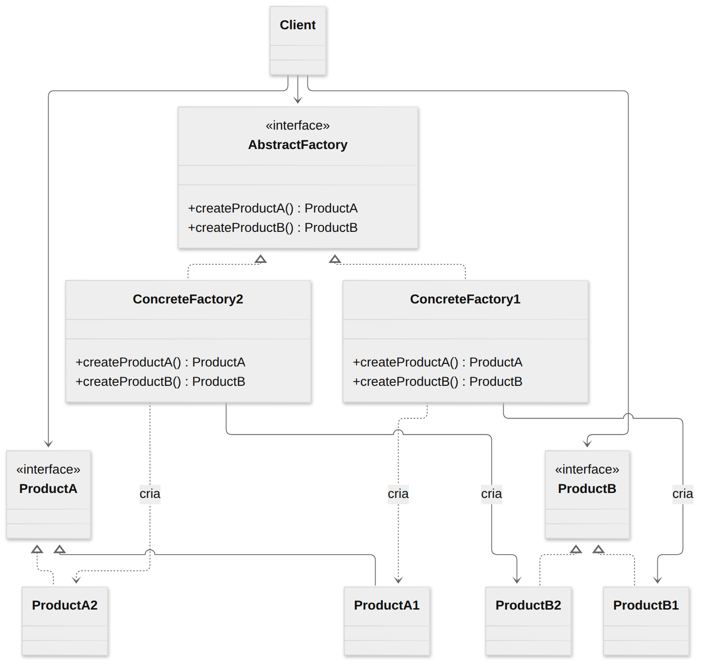
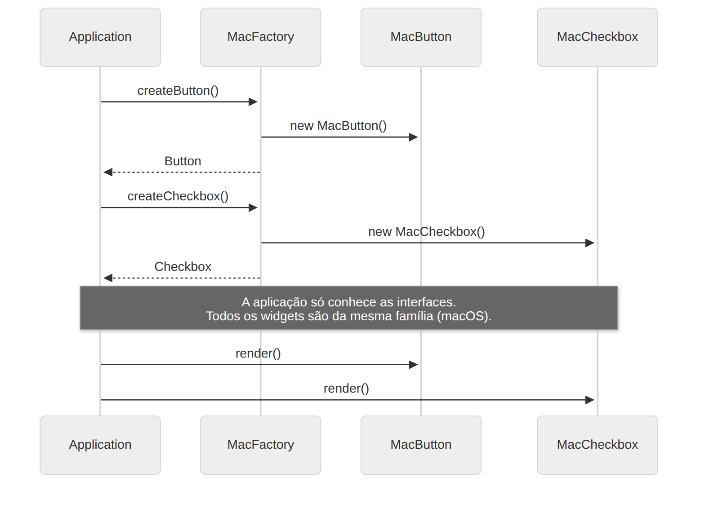

# Abstract Factory

> **Categoria:** Criacional · **Também conhecido como:** Kit

## Intenção

Fornecer uma interface para criar **famílias de objetos relacionados** ou dependentes, **sem especificar suas classes concretas**.

## O problema

Você está construindo um kit de interface gráfica. Existem *famílias* de widgets: botão, checkbox, menu… e cada família tem variantes (Windows, macOS, Linux). Os widgets de uma mesma variante precisam combinar entre si — um botão Windows ao lado de um checkbox macOS seria inconsistente.

Além disso, você não quer alterar o código toda vez que uma nova variante for adicionada.

## A solução

1. Declare **interfaces** para cada tipo de produto (`Button`, `Checkbox`).
2. Declare uma **fábrica abstrata** (`GUIFactory`) com um método de criação para cada produto.
3. Crie uma **fábrica concreta** por variante (`WindowsFactory`, `MacFactory`); cada uma devolve produtos *da sua família*.
4. O cliente recebe uma `GUIFactory` e a usa para criar produtos — nunca instancia classes concretas.

Como a fábrica só entrega produtos da própria família, **a consistência é garantida pela construção**.

## Estrutura





| Participante | Papel | No exemplo |
|---|---|---|
| **AbstractProduct** | Interface de cada tipo de produto | `Button`, `Checkbox` |
| **ConcreteProduct** | Produto de uma variante específica | `WindowsButton`, `MacCheckbox`… |
| **AbstractFactory** | Interface com os métodos de criação | `GUIFactory` |
| **ConcreteFactory** | Cria produtos de uma variante | `WindowsFactory`, `MacFactory` |
| **Client** | Usa apenas as interfaces abstratas | `Application` |

## Exemplo prático

[`exemplo.ts`](exemplo.ts) — a `Application` recebe uma `GUIFactory` no construtor:

```ts
class Application {
  constructor(factory: GUIFactory) {
    this.button = factory.createButton();
    this.checkbox = factory.createCheckbox();
  }
}

new Application(new MacFactory()).paint();     // widgets macOS
new Application(new WindowsFactory()).paint(); // widgets Windows
```

A decisão de *qual* fábrica usar acontece em **um único lugar** (`createFactoryFor`), tipicamente na inicialização da aplicação, baseada em configuração ou no SO.

Executar:

```bash
npx tsx 01-criacionais/abstract-factory/exemplo.ts
```

## Quando usar

- Quando o código precisa trabalhar com **várias famílias de produtos relacionados**, sem depender das classes concretas.
- Quando uma classe tem vários **Factory Methods** que começam a obscurecer sua responsabilidade principal: extrair para uma fábrica abstrata deixa a classe focada.
- Exemplos reais: temas de UI, drivers de banco de dados (conexão + comando + transação do mesmo fornecedor), kits de renderização.

## Prós e contras

| ✅ Prós | ❌ Contras |
|---|---|
| Garante compatibilidade entre os produtos de uma família | Muitas interfaces e classes novas: complexidade extra |
| Evita acoplamento entre cliente e produtos concretos | Adicionar um **novo tipo de produto** (ex.: `Slider`) obriga alterar a interface e **todas** as fábricas |
| Criação concentrada num só lugar (Responsabilidade Única) | |
| Aberto/Fechado: novas famílias sem quebrar o cliente | |

## Abstract Factory × Factory Method

| | Factory Method | Abstract Factory |
|---|---|---|
| Cria | **Um** produto | **Família** de produtos |
| Mecanismo | Herança (subclasse sobrescreve) | Composição (objeto fábrica é passado ao cliente) |
| Eixo de variação | Qual produto | Qual família |

## Relação com outros padrões

- Uma Abstract Factory costuma ser implementada como um conjunto de **Factory Methods**, mas também pode usar **Prototype** para compor os produtos.
- Pode ser uma alternativa a **Facade** quando você só quer esconder *como* os objetos são criados.
- Pode trabalhar com **Bridge**: a abstração usa a fábrica para obter a implementação correta.
- As fábricas concretas costumam ser **Singletons**.
