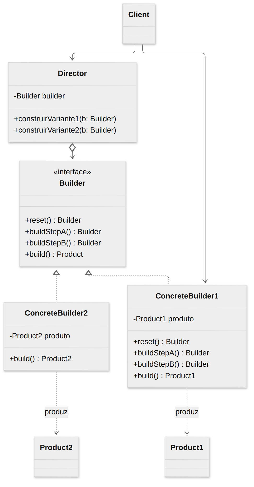
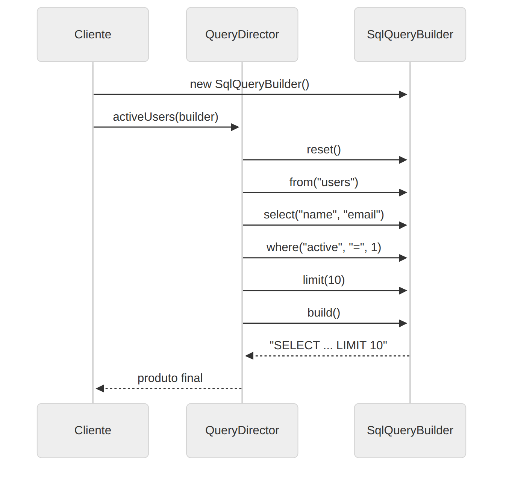

# Builder

> **Categoria:** Criacional

## Intenção

**Separar a construção de um objeto complexo da sua representação**, de modo que o mesmo processo de construção possa criar representações diferentes.

## O problema

Imagine um objeto com muitas configurações opcionais: uma consulta SQL, uma requisição HTTP, uma casa. Duas abordagens ruins:

- **Construtor gigante** — `new Query("users", ["name", "email"], undefined, undefined, 10, null, true)`: ninguém lembra a ordem dos parâmetros, e a maioria dos `undefined` é ruído.
- **Uma subclasse para cada combinação** — explosão de classes (`QueryComLimit`, `QueryComWhereELimit`…).

## A solução

Extraia o código de construção para fora da classe e coloque-o em objetos separados chamados **builders**. A construção é dividida em **passos** (`from`, `select`, `where`, `limit`) que você chama só se precisar; no final, `build()` devolve o produto.

Opcionalmente, um **Diretor** guarda *receitas* — sequências de passos que se repetem — e as aplica a qualquer builder. Assim, o mesmo roteiro gera produtos diferentes dependendo do builder usado.

## Estrutura





| Participante | Papel | No exemplo |
|---|---|---|
| **Builder** | Interface com os passos de construção | `QueryBuilder<T>` |
| **ConcreteBuilder** | Implementa os passos e guarda o produto parcial | `SqlQueryBuilder`, `MongoQueryBuilder` |
| **Product** | O objeto construído (pode ser de tipos sem relação entre si) | `string` (SQL) e `MongoQuery` |
| **Director** *(opcional)* | Define a **ordem** dos passos para receitas comuns | `QueryDirector` |
| **Client** | Escolhe o builder, e opcionalmente o diretor | `main()` |

## Exemplo prático

[`exemplo.ts`](exemplo.ts) — dois builders, um diretor e uso direto:

```ts
// Com diretor: a receita é reaproveitada para produtos diferentes
QueryDirector.activeUsers(new SqlQueryBuilder());
// SELECT name, email FROM users WHERE active = 1 LIMIT 10
QueryDirector.activeUsers(new MongoQueryBuilder());
// { collection: "users", filter: { active: 1 }, projection: {...}, limit: 10 }

// Sem diretor: interface fluente (method chaining)
new SqlQueryBuilder().from("orders").select("id").where("total", ">", 500).build();
```

Os métodos retornam `this`, o que permite o encadeamento (*fluent interface*).

Executar:

```bash
npx tsx 01-criacionais/builder/exemplo.ts
```

> ⚠️ O exemplo concatena valores direto na string SQL para ficar didático. Em produção, use **consultas parametrizadas** para evitar SQL Injection.

## Quando usar

- Para se livrar do "**construtor telescópico**" (construtores com muitos parâmetros opcionais).
- Quando você quer criar **diferentes representações** do mesmo produto (SQL × Mongo, HTML × Markdown).
- Para construir **árvores Composite** ou outros objetos complexos passo a passo (e com recursão).

## Prós e contras

| ✅ Prós | ❌ Contras |
|---|---|
| Construção passo a passo, adiando ou ignorando passos | O código fica mais complexo (várias classes novas) |
| Reaproveita o mesmo código de construção em várias representações | Builder precisa ser **mutável** durante a montagem |
| Responsabilidade Única: isola a construção da lógica de negócio | |
| Código legível: `.where().limit()` no lugar de `new X(null, null, 5)` | |

## Dicas para TypeScript

Para objetos simples, muitas vezes um **parâmetro de objeto com campos opcionais** basta e é mais leve que um Builder:

```ts
createQuery({ from: "users", limit: 10 });
```

Use Builder de verdade quando houver **passos com ordem/regras**, validação no `build()` ou **múltiplas representações**.

## Relação com outros padrões

- Muitos projetos começam com **Factory Method** e evoluem para **Builder** quando a criação fica complexa.
- **Builder** foca em construir objetos complexos **passo a passo**; **Abstract Factory** cria **famílias** de objetos e devolve o resultado imediatamente.
- Builders são ótimos para montar árvores **Composite**.
- Um Builder pode ser implementado como **Singleton** se for *stateless* (mas normalmente guarda estado).
