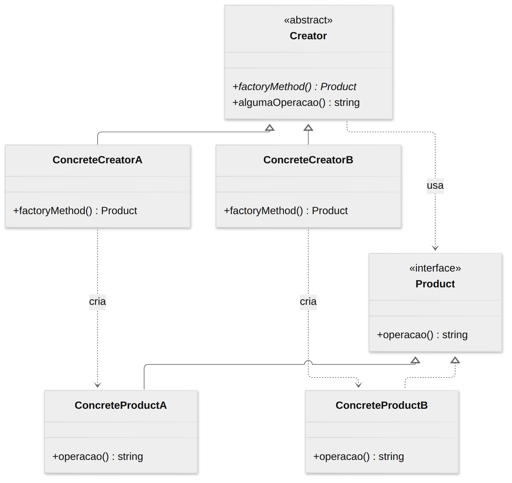
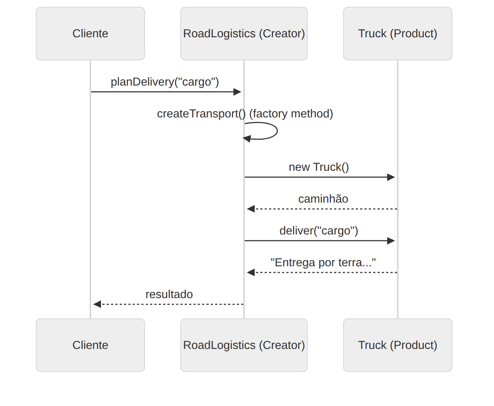

# Factory Method

> **Categoria:** Criacional · **Também conhecido como:** Construtor Virtual (*Virtual Constructor*)

## Intenção

Definir uma **interface para criar um objeto**, mas deixar que as **subclasses decidam qual classe instanciar**. O Factory Method adia a instanciação para as subclasses.

## O problema

Seu app de logística começou só com caminhões, e o código está cheio de `new Truck()`. Agora chega um cliente que quer frete marítimo. Adicionar `Ship` significa percorrer o código inteiro inserindo `if (tipo === "navio")`. Cada novo meio de transporte multiplica os condicionais e acopla a lógica de negócio às classes concretas.

## A solução

Substitua as chamadas diretas `new Truck()` por chamadas a um **método fábrica** (*factory method*). As subclasses sobrescrevem esse método para devolver produtos diferentes. O código que *usa* o produto só enxerga a interface comum (`Transport`) e não se importa com a classe real.

> O método fábrica não precisa ser a única responsabilidade da classe criadora. Normalmente ela contém lógica de negócio importante que **depende** do produto — e é por isso que o padrão vale a pena.

## Estrutura





| Participante | Papel | No exemplo |
|---|---|---|
| **Product** | Interface comum a todos os produtos | `Transport` |
| **ConcreteProduct** | Implementações do produto | `Truck`, `Ship`, `Plane` |
| **Creator** | Declara o factory method e usa o produto | `Logistics` |
| **ConcreteCreator** | Sobrescreve o factory method para devolver um produto concreto | `RoadLogistics`, `SeaLogistics`, `AirLogistics` |

## Exemplo prático

[`exemplo.ts`](exemplo.ts) — `Logistics.planDelivery()` contém o fluxo de negócio e chama `this.createTransport()`; cada subclasse decide o que devolver:

```ts
abstract class Logistics {
  protected abstract createTransport(): Transport; // factory method

  planDelivery(cargo: string): string {
    return this.createTransport().deliver(cargo);
  }
}

class SeaLogistics extends Logistics {
  protected override createTransport(): Transport {
    return new Ship();
  }
}
```

Executar:

```bash
npx tsx 01-criacionais/factory-method/exemplo.ts
```

## Quando usar

- Quando você **não sabe de antemão** os tipos exatos dos objetos com que o código vai trabalhar.
- Quando quer **permitir que usuários/extensões** do seu framework criem seus próprios componentes (ex.: sobrescrever o método para devolver o componente customizado).
- Quando quer **reaproveitar objetos** existentes (pool, cache) em vez de recriá-los: o factory method pode devolver um objeto já existente.

## Prós e contras

| ✅ Prós | ❌ Contras |
|---|---|
| Evita acoplamento entre criador e produtos concretos | O código fica mais complexo: surgem muitas subclasses |
| Princípio da Responsabilidade Única: a criação fica num lugar só | Para cada novo produto, normalmente cria-se também uma subclasse criadora |
| Princípio Aberto/Fechado: novos produtos sem quebrar código existente | |

## Variações e dicas

- **Factory Method parametrizado:** um único método recebe um argumento (`create("truck")`) e decide o que criar. É mais simples, mas perde a vantagem do polimorfismo e do Aberto/Fechado.
- **Simple Factory** (função ou classe estática com `switch`) **não** é o Factory Method do GoF — é um atalho útil, mas sem herança.

## Relação com outros padrões

- Muitos projetos começam com **Factory Method** (simples, via subclasses) e evoluem para **Abstract Factory**, **Prototype** ou **Builder** (mais flexíveis).
- Classes **Abstract Factory** costumam ser implementadas com um conjunto de Factory Methods.
- Factory Method é uma especialização do **Template Method**: `planDelivery()` é um *template* e `createTransport()` é o passo que varia.
- Pode ser usado junto com **Iterator** para que subclasses de coleções devolvam iteradores compatíveis.
