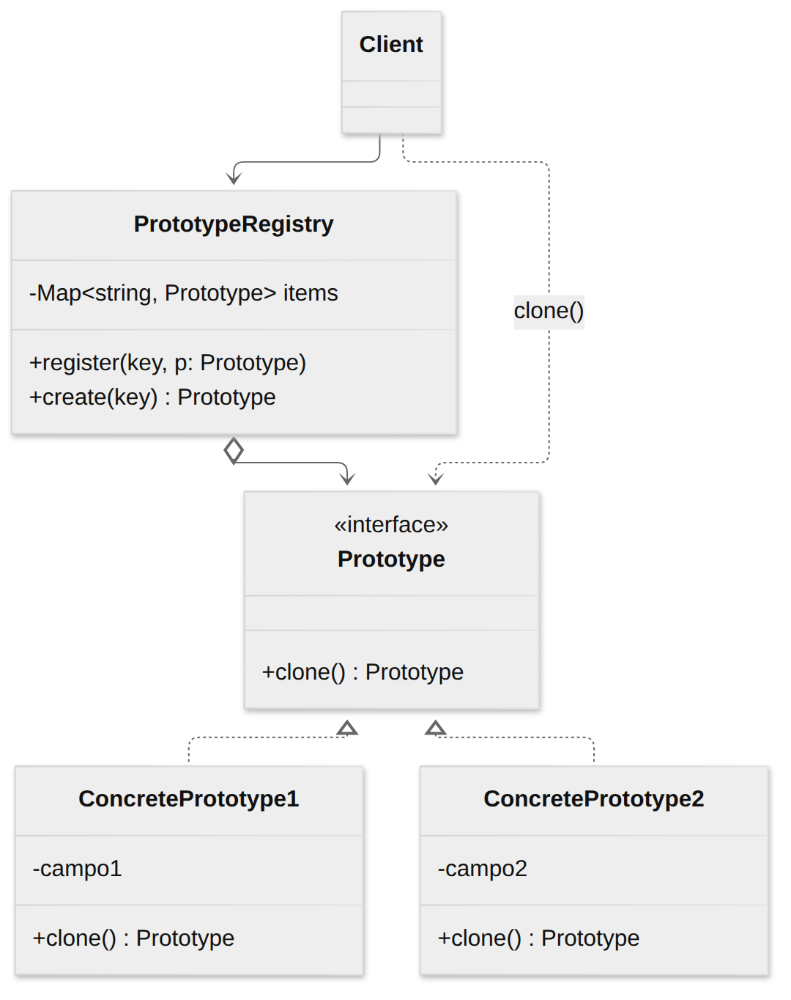
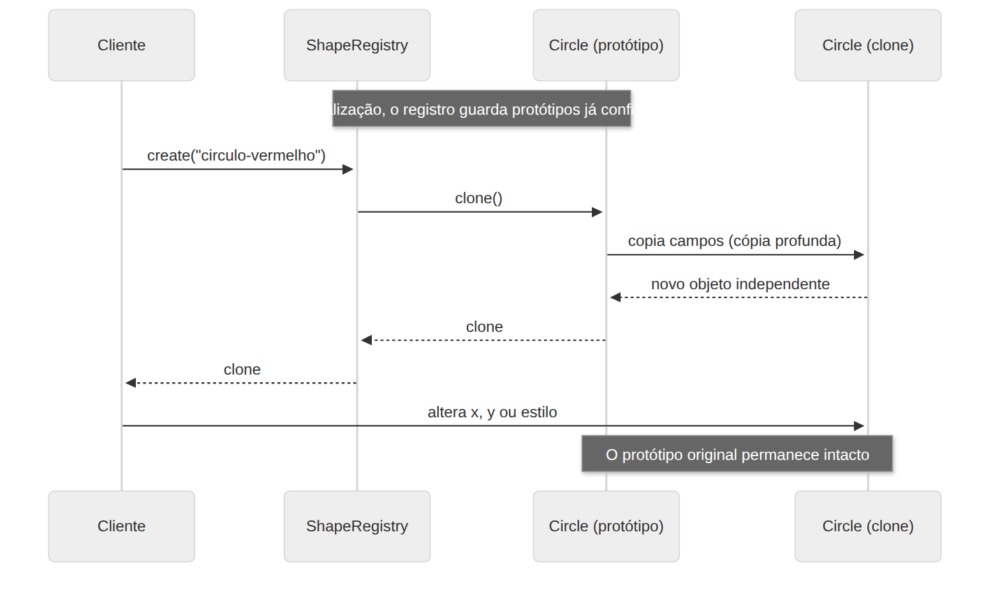

# Prototype

> **Categoria:** Criacional · **Também conhecido como:** Clone

## Intenção

Permitir **copiar objetos existentes** sem que o código dependa das suas classes concretas.

## O problema

Você tem um objeto e quer uma cópia exata dele. Copiar "de fora" é problemático:

- Nem todos os campos são visíveis (campos `private`).
- Você precisa conhecer a **classe concreta** do objeto para instanciar uma nova, o que acopla seu código a ela.
- Às vezes você só tem uma **interface** e não sabe qual classe está por trás.
- Criar do zero pode ser caro (carregar dados, configurar muitas opções).

## A solução

Delegue a clonagem **ao próprio objeto**. Declare uma interface com um método `clone()`; cada classe o implementa criando uma cópia de si mesma, com acesso total aos próprios campos. Quem precisa de uma cópia chama `obj.clone()` sem saber a classe concreta.

Um objeto que suporta clonagem é chamado de **protótipo**. Você pode ainda guardar protótipos pré-configurados num **registro** (catálogo) e cloná-los sob demanda — uma alternativa à criação de subclasses para cada configuração.

## Estrutura





| Participante | Papel | No exemplo |
|---|---|---|
| **Prototype** | Interface com `clone()` | `Prototype<T>` / `Shape` |
| **ConcretePrototype** | Implementa `clone()` copiando seus campos | `Circle`, `Rectangle` |
| **Registry** *(opcional)* | Catálogo de protótipos prontos | `ShapeRegistry` |
| **Client** | Pede cópias sem conhecer a classe concreta | `main()` |

## Exemplo prático

[`exemplo.ts`](exemplo.ts) — um editor gráfico que duplica formas.

```ts
const botao = registry.create("botao"); // clona o protótipo "botao"
botao.x = 200;                          // a cópia é independente do original
```

O exemplo demonstra três coisas:

1. **Clonagem polimórfica:** `shape.clone()` devolve a subclasse correta.
2. **Cópia rasa × profunda:** o campo `style` é um objeto aninhado. Com `Object.assign` (cópia rasa) a cópia e o original **compartilham** o mesmo `style`: alterar um altera o outro. Em `clone()` usamos `structuredClone(this.style)` para uma **cópia profunda**.
3. **Registro de protótipos:** um catálogo de objetos já configurados.

Executar:

```bash
npx tsx 01-criacionais/prototype/exemplo.ts
```

## Cópia rasa × profunda em JavaScript/TypeScript

| Técnica | Tipo | Observação |
|---|---|---|
| `{ ...obj }`, `Object.assign` | Rasa | Objetos aninhados continuam compartilhados |
| `structuredClone(obj)` | Profunda | Nativa (Node 17+). Perde protótipos/métodos e não copia funções |
| `JSON.parse(JSON.stringify(obj))` | Profunda | Perde `Date`, `Map`, `undefined`, funções… evite |
| `clone()` manual | Profunda | A mais controlável; recomendada para classes |

> `structuredClone` devolve objetos "planos", sem métodos de classe. Por isso o `clone()` reconstrói a instância com `new Circle(...)` e usa `structuredClone` apenas nos dados aninhados.

## Quando usar

- Quando seu código **não deve depender das classes concretas** dos objetos que precisa copiar.
- Para **reduzir subclasses** que só diferem na configuração inicial: em vez de `BotaoVermelho`, `BotaoAzul`, clone um protótipo configurado.
- Quando criar um objeto do zero é **caro** (carregar dados, consultar a rede).

## Prós e contras

| ✅ Prós | ❌ Contras |
|---|---|
| Clona objetos sem acoplar às suas classes concretas | Clonar objetos com **referências circulares** é difícil |
| Evita código de inicialização repetido | Cópia profunda de estruturas complexas exige cuidado |
| Produz objetos complexos mais rápido | |
| Alternativa à herança para configurações pré-definidas | |

## Relação com outros padrões

- Projetos que começam com **Factory Method** podem evoluir para **Prototype** (menos subclasses).
- **Abstract Factory** pode ser implementada com Prototype para compor os produtos.
- Prototype ajuda a salvar cópias de **Commands** no histórico (desfazer/refazer).
- Projetos com muito **Composite** e **Decorator** se beneficiam de Prototype para clonar estruturas complexas.
- **Memento** pode ser uma alternativa mais simples a Prototype quando você só quer guardar o estado de um objeto.
