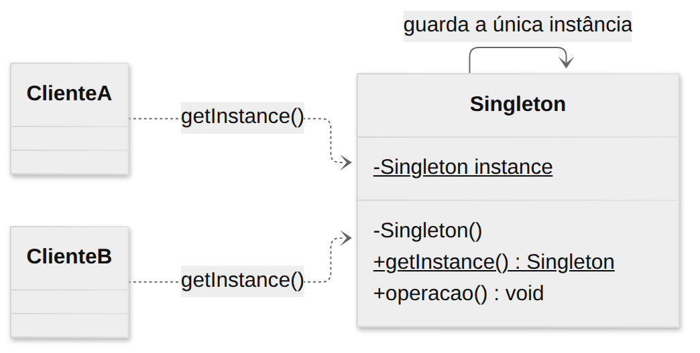
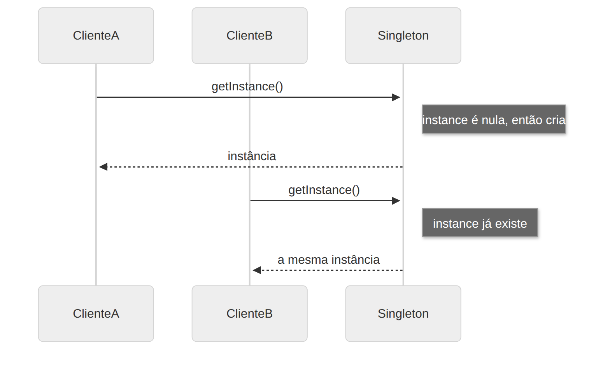

# Singleton

> **Categoria:** Criacional · **Também conhecido como:** Instância Única

## Intenção

Garantir que uma classe tenha **apenas uma instância** e fornecer um **ponto de acesso global** a ela.

## O problema

Alguns recursos só fazem sentido quando existe um único exemplar: a conexão com o banco, o gerenciador de configurações, o *pool* de threads, o *logger*. Se cada parte do código fizer `new Database()`, você abre várias conexões caras, cria estados divergentes e desperdiça recursos.

Uma variável global resolveria o acesso, mas não impede que alguém sobrescreva o valor ou crie outra instância.

## A solução

1. Torne o **construtor privado**, para que ninguém consiga usar `new` de fora.
2. Crie um **método estático** (`getInstance()`) que serve de construtor alternativo: na primeira chamada cria o objeto e o guarda num campo estático; nas seguintes, devolve o objeto guardado.

## Estrutura





| Participante | Papel |
|---|---|
| **Singleton** | Declara `getInstance()`, que devolve a instância única, e guarda essa instância num campo estático privado. |
| **Cliente** | Obtém o objeto sempre via `getInstance()`, nunca via `new`. |

## Exemplo prático

[`exemplo.ts`](exemplo.ts) implementa uma conexão de banco de dados:

```ts
const a = Database.getInstance(); // cria a conexão
const b = Database.getInstance(); // reaproveita a mesma
console.log(a === b);             // true
```

- O construtor `private` faz o compilador rejeitar `new Database()` (veja o `@ts-expect-error` no arquivo).
- O arquivo também mostra a **alternativa idiomática**: em Node/ES Modules, `export const logger = new AppLogger()` já é um singleton, porque o módulo é avaliado uma única vez e fica em cache.

Executar:

```bash
npx tsx 01-criacionais/singleton/exemplo.ts
```

## Quando usar

- Quando for **necessário** ter exatamente uma instância de um recurso compartilhado (conexão, configuração, cache).
- Quando você precisa de controle mais rígido sobre variáveis globais.

## Prós e contras

| ✅ Prós | ❌ Contras |
|---|---|
| Garante uma única instância | Viola o Princípio da Responsabilidade Única (controla a criação **e** faz o trabalho) |
| Ponto de acesso global | Esconde dependências: o código "puxa" o singleton de onde quiser |
| Inicialização *lazy* (só quando usado) | Dificulta testes unitários (estado global persiste entre testes) |
| | Em linguagens com várias threads exige sincronização (no Node, que é *single-thread*, isso não é problema) |

## Armadilhas

- O `private` do TypeScript só existe em **tempo de compilação**. Em JavaScript puro, `new Database()` ainda funcionaria.
- Singletons com estado mutável viram "globais disfarçadas". Prefira **injeção de dependência**: crie a instância uma vez na raiz da aplicação e passe-a para quem precisa — você obtém a instância única sem o acoplamento global.

## Relação com outros padrões

- **Facade** costuma ser um Singleton, pois um único objeto fachada basta.
- **Abstract Factory**, **Builder** e **Prototype** podem ser implementados como Singletons.
- **Flyweight** parece Singleton se você reduzir a poucos objetos compartilhados, mas Flyweight pode ter várias instâncias e elas são imutáveis.
