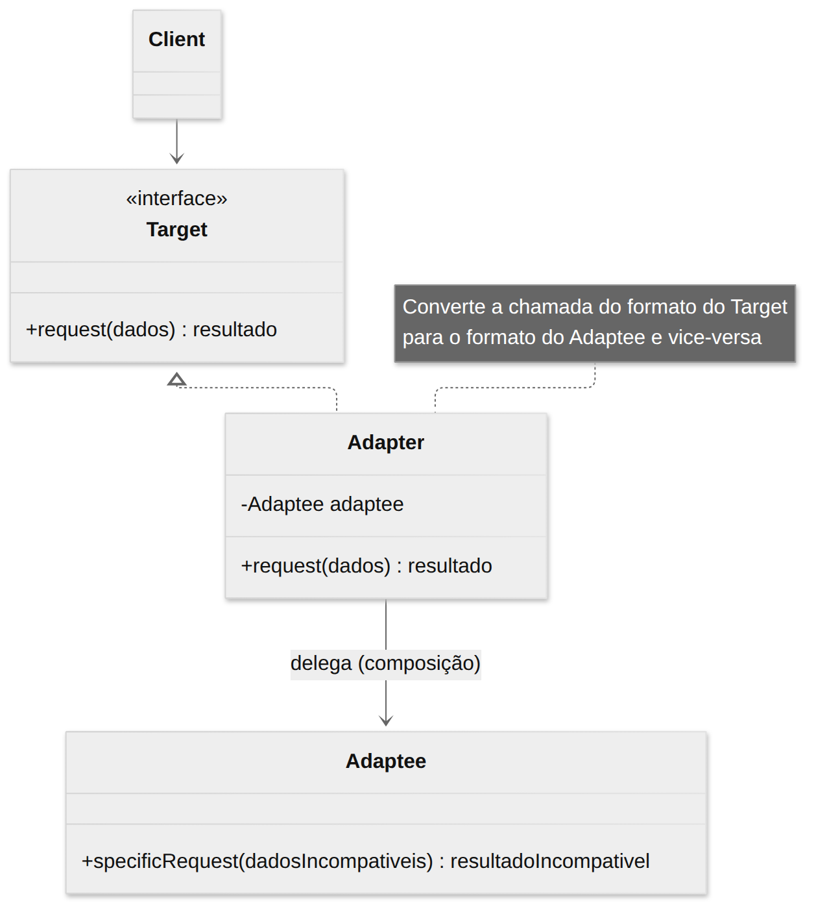
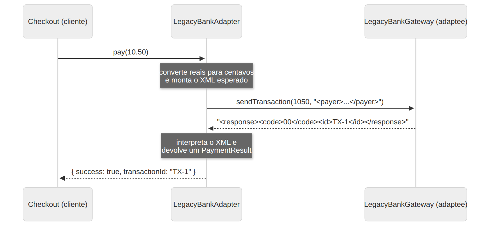

# Adapter

> **Categoria:** Estrutural · **Também conhecido como:** Wrapper (Invólucro)

## Intenção

Permitir que objetos com **interfaces incompatíveis** colaborem. O Adapter converte a interface de uma classe na interface que o cliente espera.

## O problema

Seu sistema de e-commerce chama `processor.pay(10.5)`. Você precisa integrar um gateway legado que só aceita **centavos** e responde em **XML**, e um SDK moderno que espera o valor como **string**. Você não pode alterar essas bibliotecas (são de terceiros ou legado), e não quer espalhar conversões por todo o código.

É como um **adaptador de tomada** de viagem: o seu notebook (cliente) tem um plugue de três pinos; a tomada da parede (serviço) é diferente; o adaptador faz a ponte.

## A solução

Crie uma classe **Adapter** que:

1. implementa a interface esperada pelo cliente (**Target**);
2. guarda uma referência ao objeto incompatível (**Adaptee**);
3. converte cada chamada do cliente para o formato que o Adaptee entende e converte a resposta de volta.

O cliente continua trabalhando só com o Target e nem percebe o adaptador.

## Estrutura

Existem duas formas: **objeto** (composição — a mais comum, usada aqui) e **classe** (herança múltipla — inexistente em TypeScript).





| Participante | Papel | No exemplo |
|---|---|---|
| **Target** | Interface que o cliente usa | `PaymentProcessor` |
| **Client** | Colabora com objetos via Target | `Checkout` |
| **Adaptee** | Classe útil mas incompatível | `LegacyBankGateway`, `FastPaySdk` |
| **Adapter** | Traduz Target ⇄ Adaptee | `LegacyBankAdapter`, `FastPayAdapter` |

## Exemplo prático

[`exemplo.ts`](exemplo.ts) — dois adapters dão ao `Checkout` a mesma interface para dois gateways bem diferentes:

```ts
new Checkout(new LegacyBankAdapter(new LegacyBankGateway())).finalize(10.5);
new Checkout(new FastPayAdapter(new FastPaySdk())).finalize(99.9);
```

O `LegacyBankAdapter` converte reais → centavos, monta o XML de entrada e interpreta o XML de saída. O `Checkout` jamais vê XML ou centavos.

Executar:

```bash
npx tsx 02-estruturais/adapter/exemplo.ts
```

## Quando usar

- Quando quer usar uma classe existente, mas sua **interface não é compatível** com o resto do código.
- Para reaproveitar várias subclasses que carecem de alguma funcionalidade comum, sem poder adicioná-la à superclasse.
- Ao integrar **bibliotecas de terceiros**, **código legado** ou **APIs externas** (anti-corruption layer).

## Prós e contras

| ✅ Prós | ❌ Contras |
|---|---|
| Responsabilidade Única: a conversão fica separada da lógica de negócio | A complexidade geral cresce com novas interfaces e classes |
| Aberto/Fechado: novos adapters sem alterar o cliente | Às vezes é mais simples alterar a classe original (se você puder) |

## Relação com outros padrões

| Padrão | Diferença para o Adapter |
|---|---|
| **Bridge** | É projetado **antecipadamente** para desacoplar abstração e implementação. Adapter é aplicado **depois**, para fazer coisas existentes funcionarem juntas. |
| **Decorator** | **Mantém** a interface e **adiciona** comportamento. Adapter **muda** a interface. |
| **Proxy** | Mantém a **mesma** interface. Adapter fornece uma interface **diferente**. |
| **Facade** | Define uma interface **nova e simplificada** para um subsistema. Adapter faz uma interface **existente** utilizável. |
