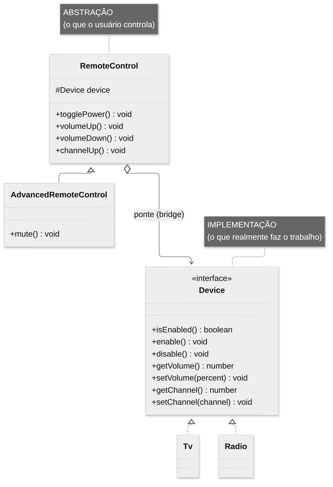
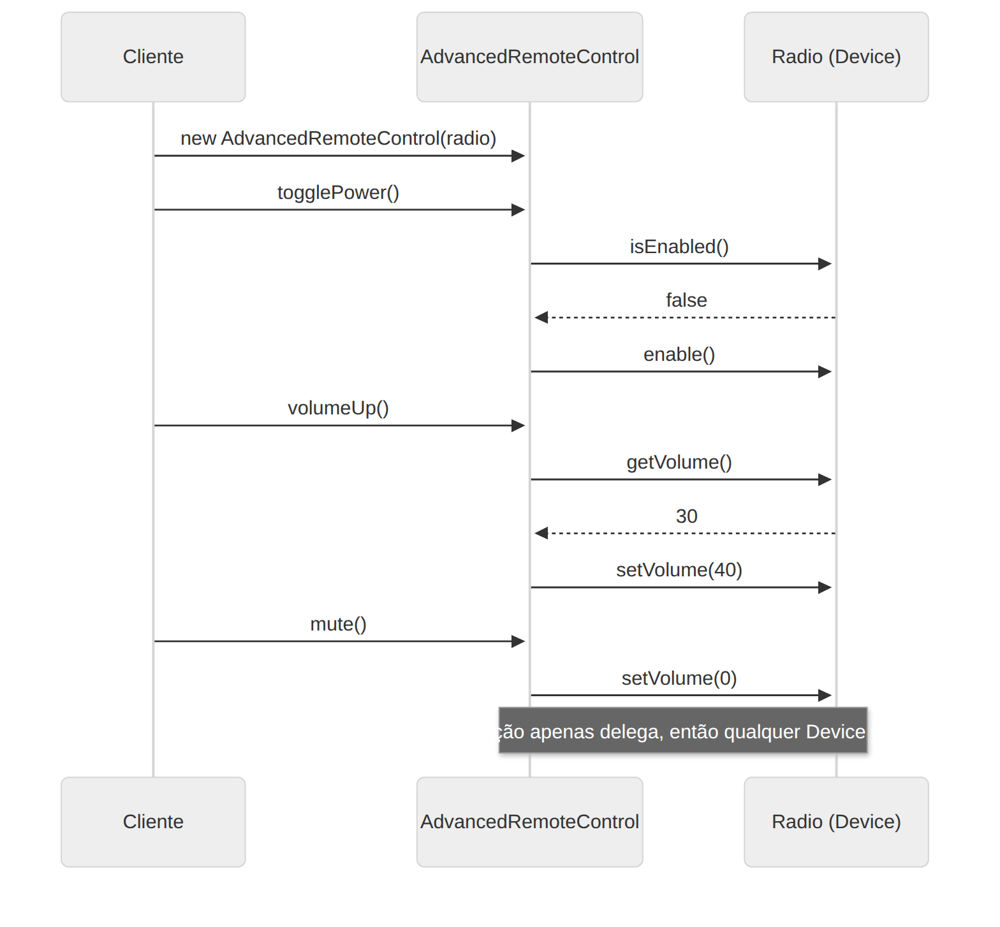

# Bridge

> **Categoria:** Estrutural · **Também conhecido como:** Handle/Body

## Intenção

**Desacoplar uma abstração da sua implementação**, para que as duas possam variar de forma independente.

## O problema

Você tem controles remotos (`RemoteControl`) e dispositivos (`Tv`, `Radio`). Se usar herança, cada combinação vira uma classe: `BasicTvRemote`, `AdvancedTvRemote`, `BasicRadioRemote`, `AdvancedRadioRemote`… Com **M** tipos de controle e **N** dispositivos, você acaba com **M × N** classes. Cada novo dispositivo ou controle multiplica o trabalho.

O erro é tentar estender a classe em **duas dimensões** ao mesmo tempo (tipo de controle *e* tipo de dispositivo) usando só herança.

## A solução

Troque **herança por composição**. Separe as duas dimensões em duas hierarquias:

- **Abstração** (`RemoteControl` e filhos): a parte "de alto nível" — o que o usuário faz.
- **Implementação** (`Device` e filhos): a parte "de baixo nível" — quem realmente faz.

A abstração mantém uma referência a um objeto de implementação (a **ponte**) e delega a ele. Agora são **M + N** classes, e você combina quaisquer duas em tempo de execução.

> ⚠️ "Abstração" e "Implementação" aqui **não** são *interface* e *classe concreta*. São dois **papéis**: um é a camada de controle (GUI, remoto), o outro é a camada que faz o trabalho (API, dispositivo, SO).

## Estrutura





| Participante | Papel | No exemplo |
|---|---|---|
| **Abstraction** | Lógica de alto nível; contém referência à implementação | `RemoteControl` |
| **RefinedAbstraction** | Variantes da lógica de controle | `AdvancedRemoteControl` |
| **Implementation** | Interface comum às implementações | `Device` |
| **ConcreteImplementation** | Código específico da plataforma | `Tv`, `Radio` |

## Exemplo prático

[`exemplo.ts`](exemplo.ts) — qualquer controle funciona com qualquer dispositivo:

```ts
new RemoteControl(new Tv());                 // básico + TV
new AdvancedRemoteControl(new Radio());      // avançado + Rádio — sem classe nova
```

Para adicionar um `Projector`, basta criar **uma** classe que implementa `Device`; todos os controles passam a funcionar com ele. Para adicionar um controle por voz, **uma** subclasse de `RemoteControl`.

Executar:

```bash
npx tsx 02-estruturais/bridge/exemplo.ts
```

## Quando usar

- Quando precisa dividir uma classe monolítica que tem **várias variantes** de uma mesma funcionalidade (ex.: trabalha com vários servidores de banco de dados).
- Quando precisa estender a classe em **dimensões ortogonais** independentes (ex.: forma × cor, UI × plataforma, notificação × canal).
- Quando precisa **trocar implementações em tempo de execução**.

## Prós e contras

| ✅ Prós | ❌ Contras |
|---|---|
| Código independente de plataforma | Pode complicar o código se aplicado a uma classe já bem coesa |
| Cliente trabalha com abstrações de alto nível | Exige identificar corretamente as duas dimensões |
| Aberto/Fechado: novas abstrações e implementações isoladas | |
| Responsabilidade Única: lógica de alto nível separada de detalhes | |

## Relação com outros padrões

- **Bridge** é projetado **no início** do desenvolvimento; **Adapter** é aplicado **depois**, para fazer classes incompatíveis trabalharem juntas.
- Bridge, **State**, **Strategy** (e até Adapter) têm estruturas parecidas: composição que delega. Mas resolvem problemas diferentes — Bridge trata de **separar hierarquias**; Strategy/State, de **trocar comportamento**.
- **Abstract Factory** pode ajudar a Bridge: a fábrica escolhe a implementação certa para a abstração.
- **Builder** pode ser um diretor e a abstração, e os builders, as implementações.
