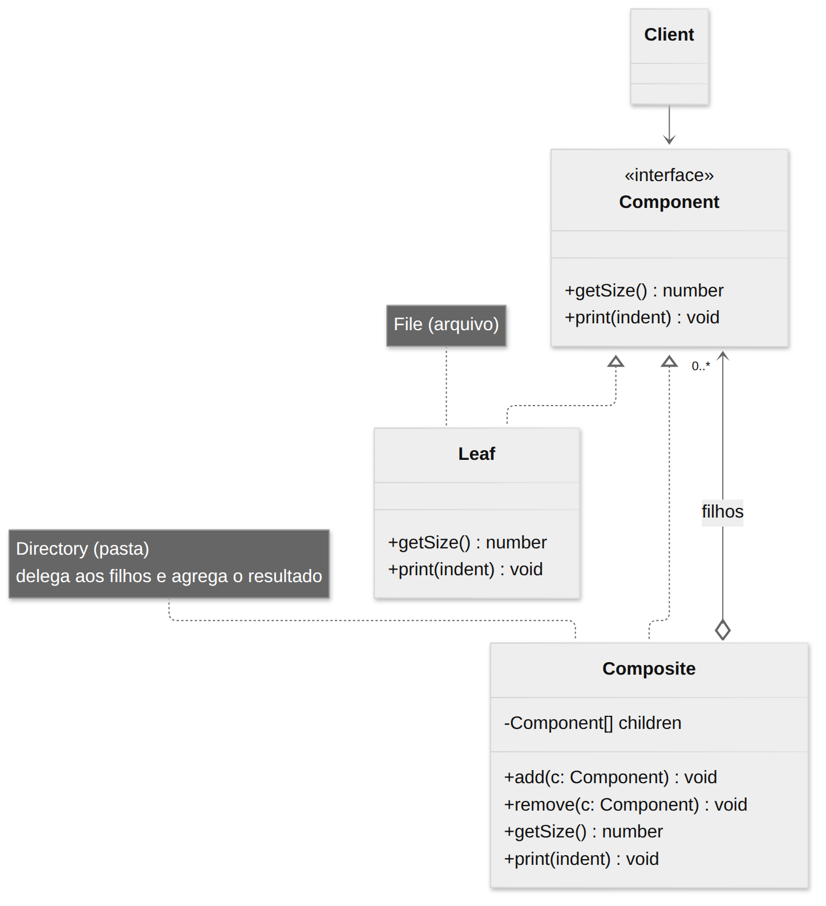
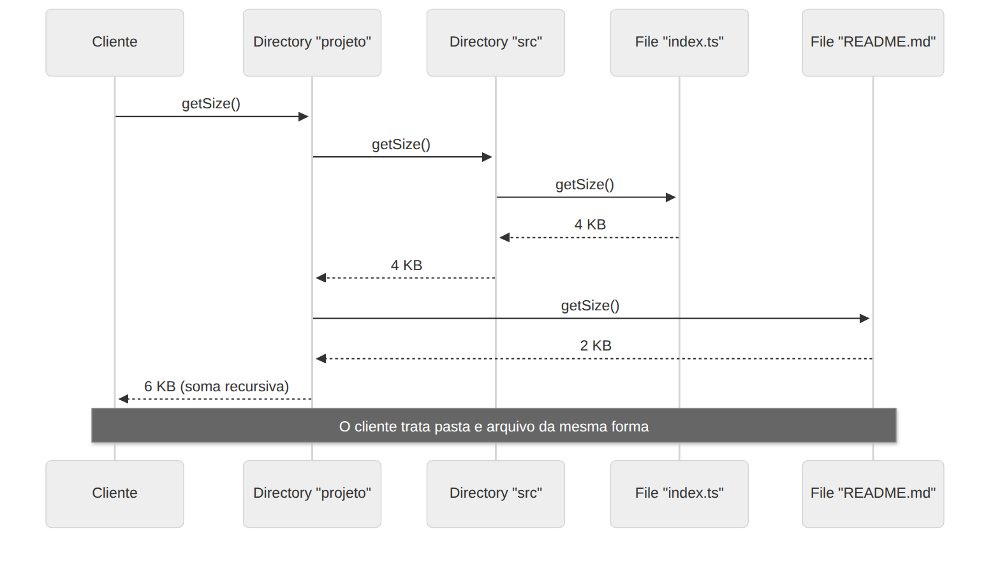

# Composite

> **Categoria:** Estrutural · **Também conhecido como:** Árvore de Objetos (*Object Tree*)

## Intenção

**Compor objetos em estruturas de árvore** para representar hierarquias parte-todo, e permitir que clientes tratem **objetos individuais e composições de objetos de maneira uniforme**.

## O problema

Pense em um sistema de arquivos: uma **pasta** contém **arquivos** e outras **pastas**. Como calcular o tamanho total de uma pasta? Sem o padrão, você precisaria percorrer manualmente, verificando `if (item é pasta) ... else ...` e controlando a profundidade da recursão.

O mesmo vale para pedidos (caixa que contém produtos e outras caixas), organogramas, menus com submenus, elementos de UI (painel com botões e painéis)…

## A solução

Só funciona se o modelo puder ser representado como uma **árvore**. Defina uma **interface comum** (`FileSystemNode`) para:

- **Folhas** (`File`): elementos simples, sem filhos; fazem o trabalho real.
- **Compostos** (`Directory`): contêm uma lista de filhos (que podem ser folhas ou outros compostos). Ao receber uma chamada, **delegam** aos filhos e **agregam** o resultado.

O cliente chama `getSize()` sem saber se está lidando com uma folha ou uma árvore inteira — a recursão acontece sozinha.

## Estrutura





| Participante | Papel | No exemplo |
|---|---|---|
| **Component** | Interface comum a simples e complexos | `FileSystemNode` |
| **Leaf** | Elemento básico, sem subelementos | `File` |
| **Composite** | Guarda filhos e delega a eles | `Directory` |
| **Client** | Trabalha com tudo via `Component` | `main()` |

## Exemplo prático

[`exemplo.ts`](exemplo.ts) — monta uma árvore de projeto e calcula tamanhos:

```ts
const project = new Directory("projeto").add(
  new Directory("src").add(new File("index.ts", 4)),
  new File("README.md", 2),
);

project.getSize(); // 6 — soma recursiva
```

Executar:

```bash
npx tsx 02-estruturais/composite/exemplo.ts
```

## Decisão de projeto: onde ficam `add`/`remove`?

| Opção | Vantagem | Desvantagem |
|---|---|---|
| Só em `Composite` (usada aqui) | **Segurança de tipos**: não dá para chamar `add` em um `File` | O cliente precisa saber quem é composto para adicionar filhos |
| Na interface `Component` | **Transparência**: tudo é tratado igual | `File.add()` não faz sentido; precisa lançar erro ou ignorar |

## Quando usar

- Quando o modelo de dados é naturalmente uma **árvore** (pastas, menus, DOM, expressões, organização).
- Quando quer que o cliente trate **elementos simples e compostos de forma uniforme**.

## Prós e contras

| ✅ Prós | ❌ Contras |
|---|---|
| Trabalha com estruturas complexas de forma conveniente via polimorfismo e recursão | Pode ser difícil fornecer uma interface comum a classes cujas funcionalidades diferem muito |
| Aberto/Fechado: novos tipos de elemento sem quebrar o código existente | A interface do Component pode ficar excessivamente genérica |

## Relação com outros padrões

- **Builder** é ótimo para criar árvores Composite complexas (a construção é recursiva).
- **Chain of Responsibility** é frequentemente usado com Composite: o filho passa a requisição para o pai.
- Você pode usar **Iterator** para percorrer árvores Composite e **Visitor** para executar operações em toda a árvore.
- Composite e **Decorator** têm diagramas parecidos (ambos usam composição recursiva), mas o Decorator tem **um** filho e **adiciona** comportamento; o Composite tem **vários** filhos e **agrega** seus resultados.
- **Flyweight** pode economizar memória compartilhando nós folha.
