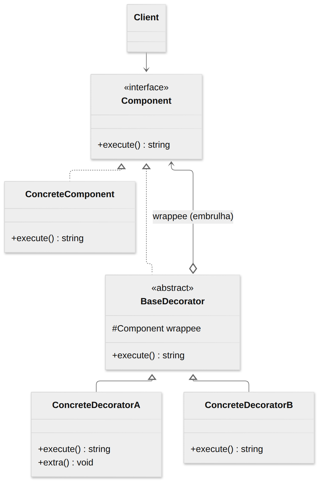
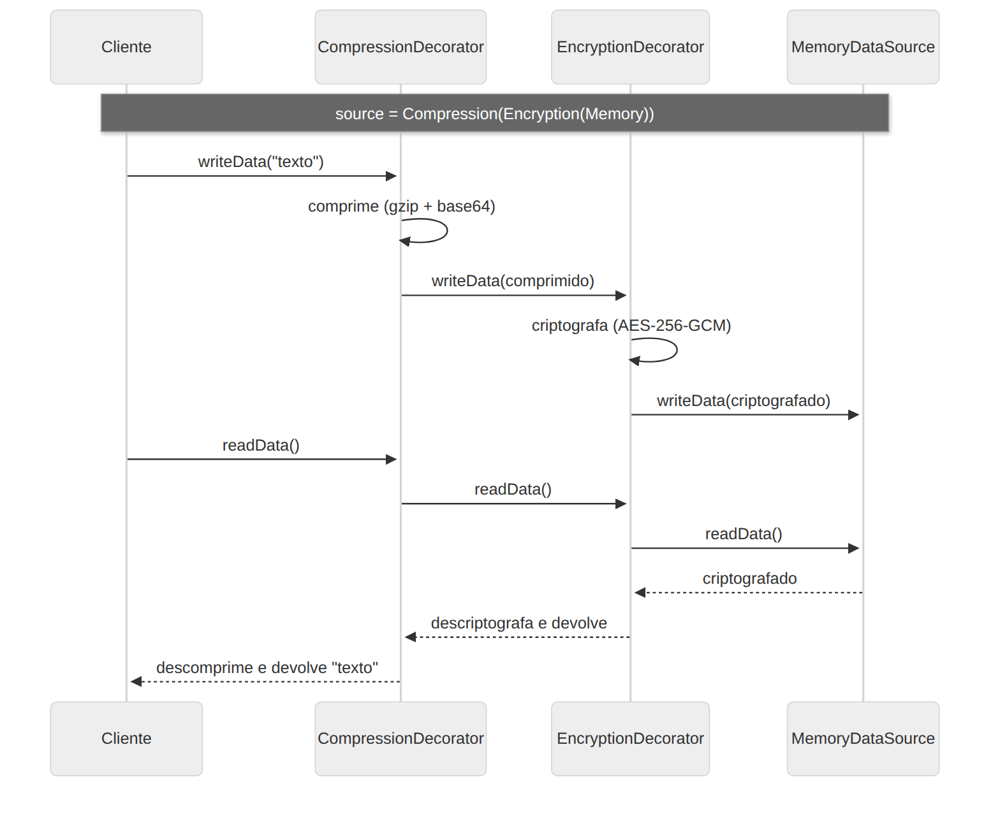

# Decorator

> **Categoria:** Estrutural · **Também conhecido como:** Wrapper (Invólucro)

## Intenção

**Anexar responsabilidades adicionais a um objeto dinamicamente.** Decorators fornecem uma alternativa flexível à herança para estender funcionalidade.

## O problema

Você tem uma fonte de dados e quer opcionalmente **comprimir**, **criptografar** e **registrar logs**. Com herança, cada combinação vira uma subclasse: `CompressedSource`, `EncryptedSource`, `CompressedEncryptedSource`, `LoggedCompressedEncryptedSource`… O número de classes explode (2ⁿ combinações).

Além disso, a herança é **estática**: você não consegue trocar o comportamento de um objeto já criado, e uma classe só pode ter **uma** superclasse.

## A solução

Use **composição** (agregação) no lugar de herança. Um *decorator* é um objeto que:

1. implementa a **mesma interface** do objeto que embrulha;
2. guarda uma **referência** ao objeto embrulhado (*wrappee*);
3. delega o trabalho a ele e **acrescenta** seu comportamento antes e/ou depois.

Como todos têm a mesma interface, você pode **empilhar** decorators como bonecas russas, na ordem e quantidade desejadas, em tempo de execução.

## Estrutura





| Participante | Papel | No exemplo |
|---|---|---|
| **Component** | Interface comum | `DataSource` |
| **ConcreteComponent** | Objeto base a ser decorado | `MemoryDataSource` |
| **BaseDecorator** | Guarda o *wrappee* e repassa as chamadas | `DataSourceDecorator` |
| **ConcreteDecorator** | Adiciona comportamento | `CompressionDecorator`, `EncryptionDecorator`, `LoggingDecorator` |
| **Client** | Monta a pilha de decorators | `main()` |

## Exemplo prático

[`exemplo.ts`](exemplo.ts) — compressão (`gzip`) e criptografia (AES-256-GCM) reais do Node:

```ts
const source = new LoggingDecorator(
  new CompressionDecorator(
    new EncryptionDecorator(new MemoryDataSource(), "segredo"),
  ),
);

source.writeData(texto); // log → comprime → criptografa → grava
source.readData();       // lê → descriptografa → descomprime → log
```

A **ordem** das camadas importa: comprimir *antes* de criptografar (dados criptografados parecem aleatórios e não comprimem). Trocar a ordem é só reorganizar o `new`, sem criar classes.

Executar:

```bash
npx tsx 02-estruturais/decorator/exemplo.ts
```

## Quando usar

- Para **adicionar responsabilidades a objetos em tempo de execução**, sem afetar outros objetos.
- Quando seria **impraticável estender por herança** (muitas combinações) ou a classe é `final`/de terceiros.
- Para comportamentos *transversais* (cache, log, retry, métricas, validação) — por isso aparece em *middlewares*.

## Prós e contras

| ✅ Prós | ❌ Contras |
|---|---|
| Estende comportamento sem criar subclasses | Difícil remover um decorator específico do meio da pilha |
| Adiciona/remove responsabilidades em tempo de execução | Difícil criar um decorator cujo comportamento **não dependa da ordem** da pilha |
| Combina vários comportamentos empilhando | O código de configuração inicial (`new A(new B(new C()))`) pode ficar feio |
| Responsabilidade Única: divide a classe monolítica em partes | |

## Não confunda com `@decorator` do TypeScript

O Decorator do GoF é um padrão de **objetos** (composição). Os `@decorators` de TypeScript/JavaScript são um recurso de **sintaxe** de metaprogramação para classes e métodos. Eles podem *implementar* a ideia do padrão, mas são coisas distintas.

## Relação com outros padrões

| Padrão | Diferença |
|---|---|
| **Adapter** | Muda a interface. Decorator mantém e **estende** a interface. |
| **Proxy** | Mesma interface, mas o Proxy controla o **acesso** e normalmente gerencia o ciclo de vida do objeto; o Decorator é composto pelo cliente. |
| **Composite** | Estrutura parecida, mas o Decorator tem **um** filho e **adiciona** comportamento; o Composite agrega **vários** filhos. |
| **Chain of Responsibility** | Também usa encadeamento recursivo, mas os handlers podem **interromper** a cadeia; decorators sempre repassam. |
| **Strategy** | Decorator muda a "**pele**" do objeto; Strategy muda suas "**entranhas**". |
