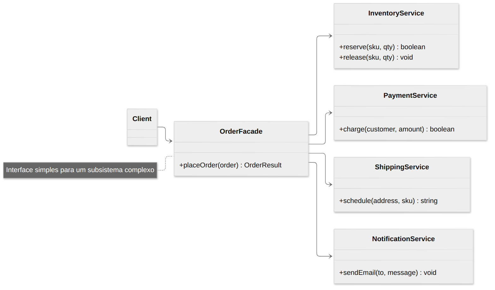
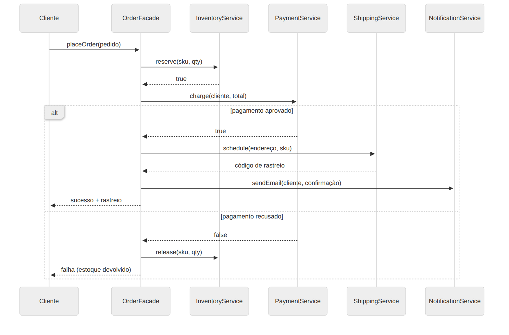

# Facade

> **Categoria:** Estrutural · **Também conhecido como:** Fachada

## Intenção

Fornecer uma **interface unificada e simplificada** para um conjunto de interfaces de um subsistema. A fachada define uma interface de nível mais alto que torna o subsistema mais fácil de usar.

## O problema

Para finalizar um pedido, o seu código precisa: reservar estoque, cobrar o pagamento, agendar a entrega e enviar e-mail — na ordem certa, devolvendo o estoque se o pagamento falhar. Se cada tela ou endpoint que cria pedidos repetir essa sequência, o código de negócio fica **acoplado** a dezenas de classes do subsistema, difícil de ler e de mudar.

## A solução

Crie uma classe **fachada** com um método de alto nível (`placeOrder`) que conhece o subsistema e executa a orquestração. Os clientes chamam só a fachada.

A fachada **não esconde** o subsistema: quem precisar de controle fino ainda pode usar as classes internas diretamente. Ela apenas oferece um **caminho fácil** para os casos comuns.

É como o atendente de uma loja por telefone: você diz "quero comprar isso" e ele cuida do estoque, do pagamento e da entrega por você.

## Estrutura





| Participante | Papel | No exemplo |
|---|---|---|
| **Facade** | Conhece quais classes do subsistema atender a cada requisição e delega | `OrderFacade` |
| **Subsystem classes** | Implementam a funcionalidade; não conhecem a fachada | `InventoryService`, `PaymentService`, `ShippingService`, `NotificationService` |
| **Client** | Usa a fachada em vez de chamar o subsistema | `main()` |

## Exemplo prático

[`exemplo.ts`](exemplo.ts) — três pedidos: um bem-sucedido, um com pagamento recusado (a fachada **devolve o estoque**) e um sem estoque:

```ts
const store = new OrderFacade();
store.placeOrder({ customer: "ana", sku: "notebook", qty: 1, unitPrice: 4500, address: "Rua A, 10" });
// → { ok: true, tracking: "BR-NOTEBOOK-..." }
```

Quem chama não sabe que existem quatro serviços, nem a ordem entre eles, nem a compensação.

Executar:

```bash
npx tsx 02-estruturais/facade/exemplo.ts
```

## Quando usar

- Quando precisa de uma **interface limitada, porém direta**, para um subsistema complexo.
- Para **estruturar um subsistema em camadas**: cada camada expõe uma fachada, reduzindo dependências entre elas.
- Para isolar seu código de uma **biblioteca complexa de terceiros**, expondo só o que você usa.

## Prós e contras

| ✅ Prós | ❌ Contras |
|---|---|
| Isola o código da complexidade do subsistema | A fachada pode virar um **objeto deus** (*god object*) acoplado a tudo |
| Reduz o acoplamento entre cliente e subsistema | Pode virar um gargalo de manutenção se acumular responsabilidades |

> 💡 Se a fachada crescer demais, divida-a em fachadas menores e coesas (por exemplo, `CheckoutFacade`, `CatalogFacade`).

## Relação com outros padrões

- **Facade** define uma **nova** interface para objetos existentes; **Adapter** faz uma interface **existente** ser utilizável.
- **Abstract Factory** pode ser alternativa à Facade quando você só quer esconder *como* os subsistemas são **criados**.
- **Mediator** também organiza a colaboração entre objetos, mas é **bidirecional**: os colegas conhecem o mediador. Na Facade, o subsistema **não conhece** a fachada, e a comunicação é **unidirecional**.
- Uma fachada costuma ser um **Singleton**, pois um único objeto basta.
- **Proxy** tem a mesma ideia de "ficar na frente" de algo, mas expõe a **mesma interface** do objeto real.
