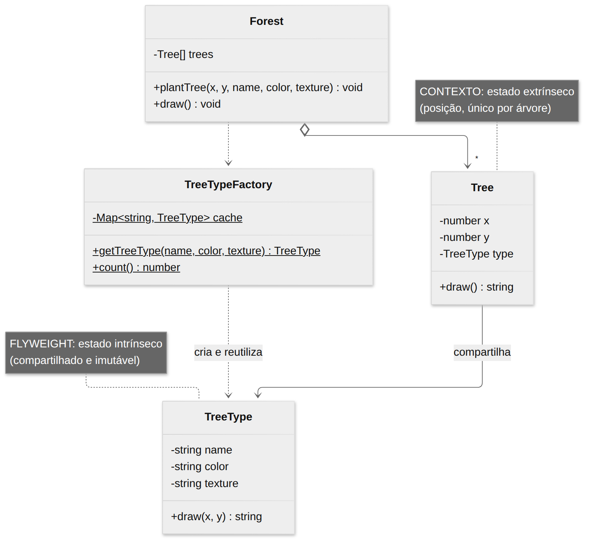
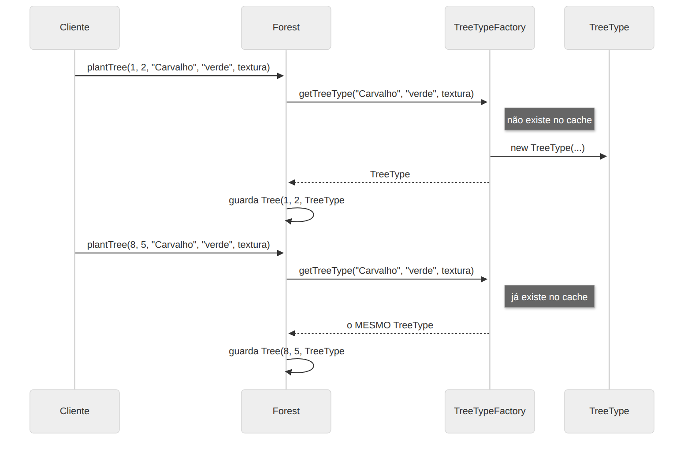

# Flyweight

> **Categoria:** Estrutural · **Também conhecido como:** Peso-Mosca, Cache

## Intenção

Usar **compartilhamento** para suportar eficientemente um grande número de objetos de granularidade fina, **economizando memória**.

## O problema

Um jogo precisa renderizar uma floresta com **100.000 árvores**. Cada árvore guarda posição `(x, y)` *e* dados pesados: espécie, cor e uma textura de 50 KB. Se cada objeto carregar sua própria textura, são ~5 GB só de texturas — mesmo havendo apenas 3 espécies diferentes. O programa trava por falta de memória.

## A solução

Separe o estado do objeto em duas partes:

| Estado | O que é | Onde fica |
|---|---|---|
| **Intrínseco** | O que se **repete** entre objetos e **não muda** (espécie, cor, textura) | No **flyweight** — um objeto compartilhado e **imutável** |
| **Extrínseco** | O que é **único** de cada objeto (posição) | No **contexto** (`Tree`) ou é passado como parâmetro pelo cliente |

Uma **fábrica** mantém um *pool*: ao receber um pedido, devolve o flyweight existente ou cria um novo. Agora são 3 texturas (150 KB) em vez de 100.000.

## Estrutura





| Participante | Papel | No exemplo |
|---|---|---|
| **Flyweight** | Guarda o estado intrínseco; recebe o extrínseco por parâmetro | `TreeType` |
| **FlyweightFactory** | Cria e gerencia o pool de flyweights | `TreeTypeFactory` |
| **Context** | Guarda o estado extrínseco e referencia um flyweight | `Tree` |
| **Client** | Calcula/armazena o estado extrínseco | `Forest` |

## Exemplo prático

[`exemplo.ts`](exemplo.ts) — planta 100.000 árvores de 3 espécies:

```
Árvores plantadas:        100.000
Flyweights (TreeType):    3
Texturas sem Flyweight: 4768.4 MB
Texturas com Flyweight: 0.1 MB
```

`TreeType` é imutável (`readonly`): como é compartilhado, **nunca** pode ser alterado por um dos clientes sem afetar os demais.

Executar:

```bash
npx tsx 02-estruturais/flyweight/exemplo.ts
```

## Quando usar

Use **somente** quando todas as condições forem verdadeiras:

- O programa precisa criar uma **quantidade enorme** de objetos semelhantes;
- Isso consome toda a memória disponível;
- Os objetos têm **estado duplicado** que pode ser extraído e compartilhado.

Exemplos reais: partículas/projéteis em jogos, caracteres em editores de texto (glifos), *tiles* de mapas, strings internadas (*string interning*).

## Prós e contras

| ✅ Prós | ❌ Contras |
|---|---|
| Economia drástica de RAM com muitos objetos semelhantes | Você troca **memória por CPU** se o estado extrínseco precisar ser recalculado |
| | Código mais complexo: dividir o estado em duas partes confunde quem chega |
| | Exige imutabilidade do flyweight |

## Relação com outros padrões

- Folhas compartilhadas de uma árvore **Composite** podem ser implementadas como Flyweights.
- Flyweight mostra como criar **muitos objetos pequenos**; **Facade** mostra como criar **um único objeto** que representa um subsistema inteiro.
- Flyweight lembra **Singleton** se reduzir a um objeto, mas: (1) Singleton tem **uma** instância, Flyweight tem **várias**; (2) o Singleton pode ser mutável, o Flyweight **não**.
