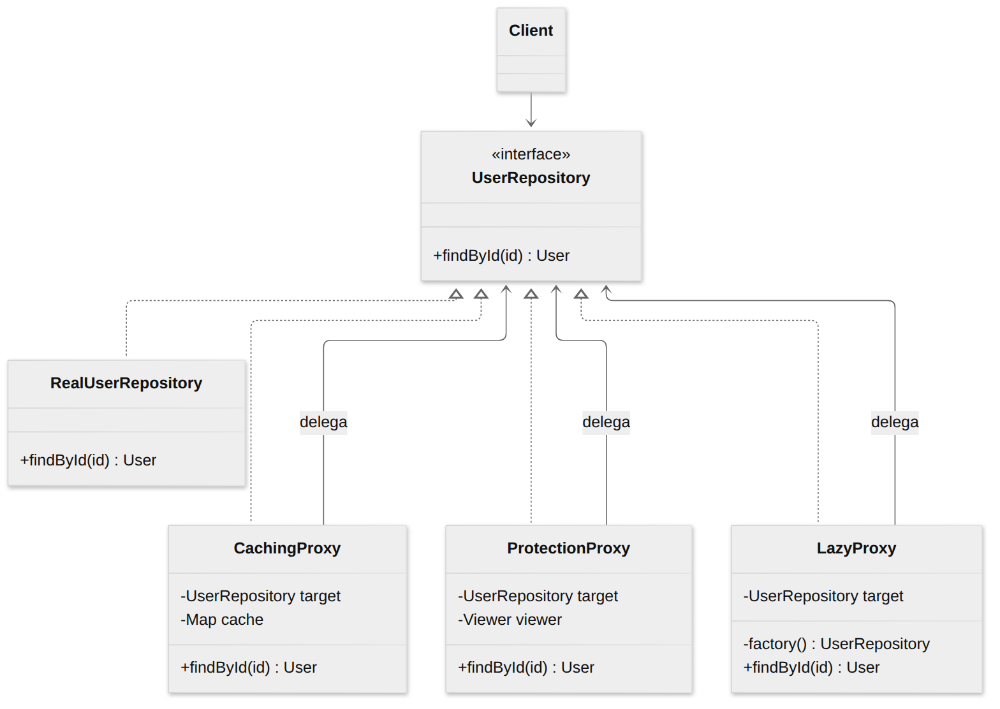
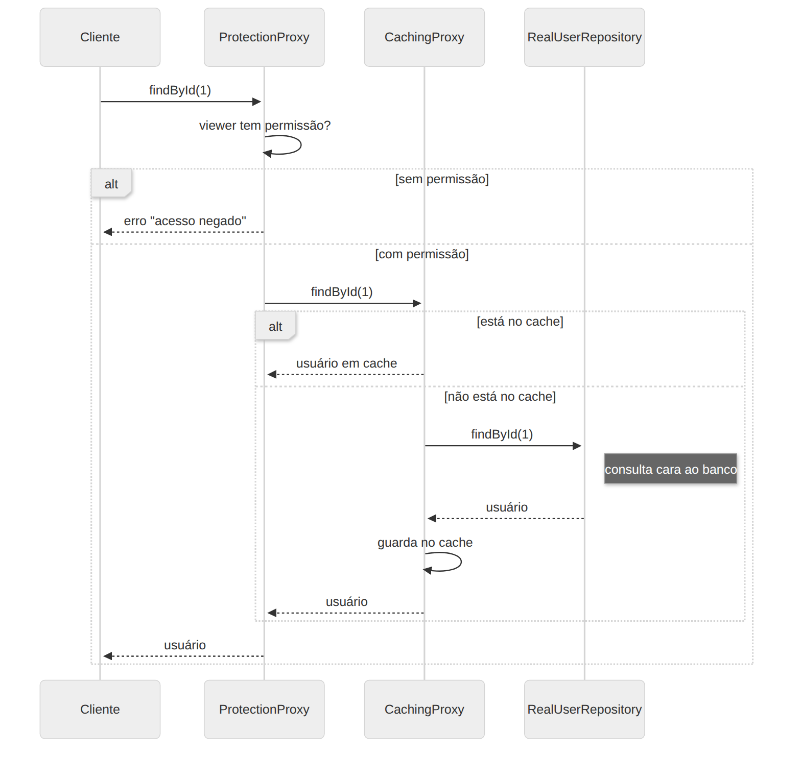

# Proxy

> **Categoria:** Estrutural · **Também conhecido como:** Substituto (*Surrogate*)

## Intenção

Fornecer um **substituto ou espaço reservado** para outro objeto, **controlando o acesso** a ele.

## O problema

Você tem um objeto pesado (conexão com o banco, serviço remoto, imagem enorme). Você gostaria de:

- só criá-lo **quando realmente usar** (inicialização preguiçosa);
- **guardar resultados em cache** para não repetir consultas caras;
- **verificar permissões** antes de deixar alguém chamá-lo;
- **registrar logs** das chamadas.

Colocar tudo isso dentro da classe original a deixa inchada e viola a Responsabilidade Única — e talvez você nem possa modificá-la (código de terceiros).

## A solução

Crie uma classe **Proxy** com a **mesma interface** do objeto real. O proxy recebe as requisições, faz seu trabalho extra (checar acesso, consultar o cache, criar o objeto sob demanda) e **repassa** ao objeto real quando necessário. Como a interface é igual, o cliente não sabe se fala com o objeto real ou com o proxy.

## Tipos comuns

| Tipo | O que faz | Exemplo no código |
|---|---|---|
| **Virtual / Lazy** | Adia a criação de um objeto caro até o primeiro uso | `LazyProxy` |
| **De cache** | Guarda resultados de requisições repetidas | `CachingProxy` |
| **De proteção** | Controla o acesso conforme permissões | `ProtectionProxy` |
| **Remoto** | Representa localmente um objeto em outro servidor (RPC, gRPC stubs) | — |
| **De log** | Registra as requisições | `withLogging` |

## Estrutura





| Participante | Papel | No exemplo |
|---|---|---|
| **ServiceInterface** | Interface comum | `UserRepository` |
| **Service** | Objeto real, com a lógica de negócio | `RealUserRepository` |
| **Proxy** | Mesma interface; guarda referência ao serviço; controla o acesso | `CachingProxy`, `ProtectionProxy`, `LazyProxy` |
| **Client** | Trabalha com serviço e proxy pela mesma interface | `main()` |

## Exemplo prático

[`exemplo.ts`](exemplo.ts) — três proxies para um repositório de usuários, que **se empilham** por compartilharem a interface:

```ts
const repo: UserRepository = new ProtectionProxy(          // 1º confere permissão
  new CachingProxy(                                          // 2º consulta o cache
    new LazyProxy(() => new RealUserRepository()),           // 3º cria o real só se preciso
  ),
  "admin",
);
```

O arquivo também mostra o **`Proxy` nativo do JavaScript** (`new Proxy(alvo, handler)`), que intercepta acesso a propriedades e métodos sem precisar escrever uma classe por interface.

Executar:

```bash
npx tsx 02-estruturais/proxy/exemplo.ts
```

## Quando usar

- **Lazy loading:** objeto pesado que fica ligado o tempo todo, mas é usado raramente.
- **Controle de acesso:** só clientes autorizados podem usar o serviço.
- **Serviço remoto:** o proxy cuida dos detalhes de rede.
- **Cache:** resultados repetidos de requisições caras.
- **Log / métricas** de chamadas sem alterar a classe.

## Prós e contras

| ✅ Prós | ❌ Contras |
|---|---|
| Controla o objeto sem o cliente perceber | O código fica mais complicado com várias classes novas |
| Gerencia o ciclo de vida do objeto real | A resposta pode atrasar (um nível a mais de indireção) |
| Funciona mesmo se o objeto real não estiver pronto/disponível | |
| Aberto/Fechado: novos proxies sem mudar serviço ou cliente | |

## Relação com outros padrões

| Padrão | Diferença |
|---|---|
| **Adapter** | Dá uma interface **diferente** ao objeto; o Proxy dá a **mesma**. |
| **Decorator** | Estrutura parecida, mas o Decorator **adiciona comportamento** e é composto pelo **cliente**; o Proxy **gerencia o ciclo de vida** do serviço por conta própria. |
| **Facade** | Também "bufferiza" uma entidade complexa e a inicializa sozinha, mas expõe uma interface **nova**, não a do objeto real. |
