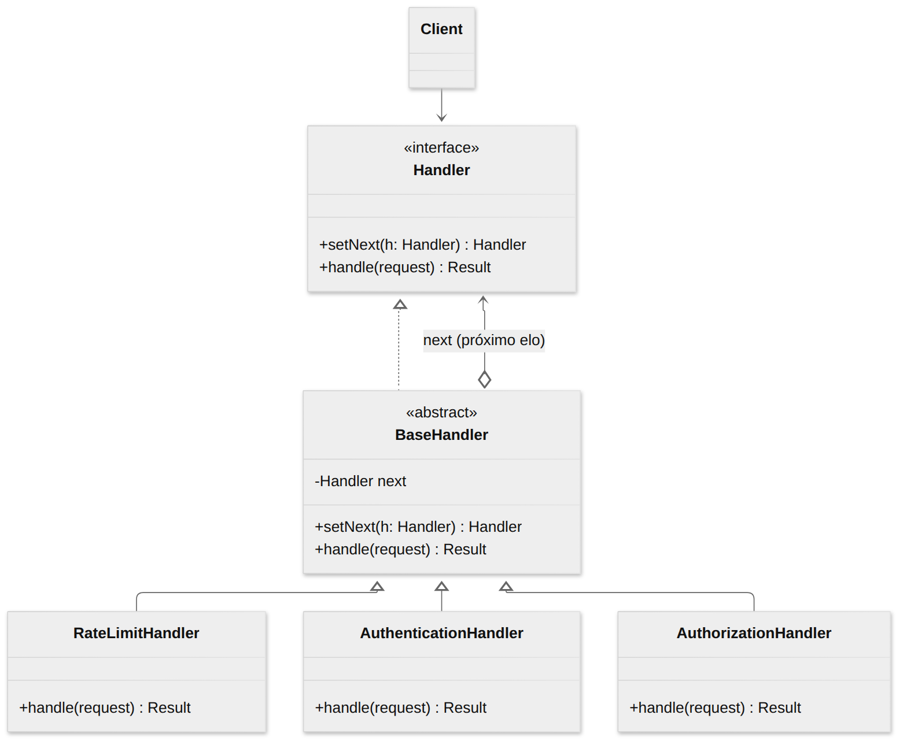
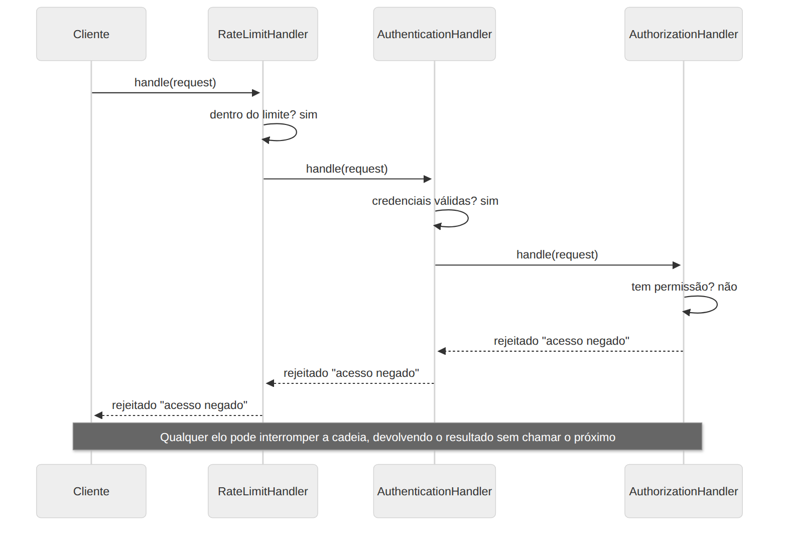

# Chain of Responsibility

> **Categoria:** Comportamental · **Também conhecido como:** Corrente de Responsabilidade, CoR, Chain of Command

## Intenção

Evitar acoplar o remetente de uma requisição ao seu receptor, dando a **mais de um objeto a chance de tratá-la**. Encadeia os receptores e passa a requisição ao longo da corrente até que um objeto a trate.

## O problema

Seu sistema precisa validar cada requisição: limite de taxa, autenticação, autorização, validação de dados, cache… Se tudo ficar num único método, vira um bloco gigante de `if`s difícil de manter e de reutilizar. Cada nova verificação aumenta a bagunça, e é impossível reaproveitar uma verificação em outro contexto.

## A solução

Transforme cada verificação em um **handler** independente, com um único método (`handle`). Encadeie-os: cada handler guarda uma referência ao **próximo**. Ao receber a requisição, o handler decide:

1. **processar e interromper** (ex.: rejeitar com erro 401); ou
2. **passar adiante** chamando o próximo da corrente.

Todos os handlers seguem a mesma interface, então o cliente pode montar e reordenar a corrente livremente.

> Existem duas variantes: a **clássica** (apenas **um** handler trata a requisição e a corrente para) e a **pipeline** (vários handlers processam, como em middlewares). O exemplo usa a pipeline com possibilidade de interrupção.

## Estrutura





| Participante | Papel | No exemplo |
|---|---|---|
| **Handler** | Interface comum a todos os handlers | `Handler` |
| **BaseHandler** | Guarda o próximo elo e implementa o repasse padrão | `BaseHandler` |
| **ConcreteHandler** | Contém a lógica; decide tratar ou repassar | `RateLimitHandler`, `AuthenticationHandler`, `AuthorizationHandler` |
| **Client** | Monta a corrente e inicia a requisição | `main()` |

## Exemplo prático

[`exemplo.ts`](exemplo.ts) — a corrente `rate limit → autenticação → autorização`:

```ts
const chain = new RateLimitHandler(3);
chain.setNext(new AuthenticationHandler()).setNext(new AuthorizationHandler());

chain.handle({ ip: "3.3.3.3", path: "/admin", user: "beto", password: "abcd" });
// ❌ 403 acesso negado a /admin
```

`setNext` devolve o handler recebido, permitindo o encadeamento fluente. Trocar a ordem ou remover um elo é só mudar a montagem.

Executar:

```bash
npx tsx 03-comportamentais/chain-of-responsibility/exemplo.ts
```

## Quando usar

- Quando o programa deve processar requisições de **várias formas**, mas os tipos e a ordem **não são conhecidos de antemão**.
- Quando é essencial executar vários handlers numa **ordem específica**.
- Quando o conjunto de handlers e a sua ordem devem poder **mudar em tempo de execução**.
- Exemplos reais: middlewares (Express, Koa), *event bubbling* no DOM, filtros de servlet, tratamento de exceções em camadas, atendimento escalonado (nível 1 → 2 → 3).

## Prós e contras

| ✅ Prós | ❌ Contras |
|---|---|
| Controle da **ordem** de tratamento | Algumas requisições podem **ficar sem tratamento** (ninguém assume) |
| Responsabilidade Única: separa quem dispara de quem executa | Depurar é mais difícil: o fluxo está espalhado por vários objetos |
| Aberto/Fechado: novos handlers sem alterar os existentes | |

## Relação com outros padrões

- Frequentemente usado com **Composite**: o filho passa a requisição ao pai.
- Handlers podem ser **Commands**; nesse caso, vários comandos são executados sobre o mesmo contexto.
- CoR e **Decorator** têm estrutura parecida (ambos usam composição recursiva), mas handlers **podem interromper** a corrente e executar operações independentes; decorators estendem o comportamento e **sempre** repassam.
- Chain of Responsibility, **Command**, **Mediator** e **Observer** são quatro formas de conectar remetentes e receptores — veja a comparação no [README da categoria](../README.md).
