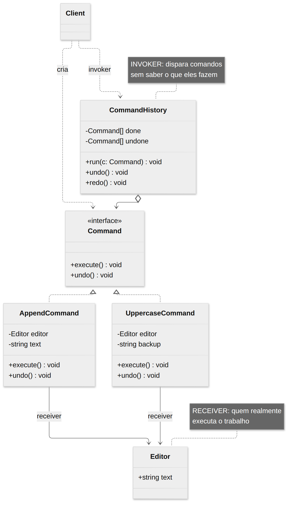
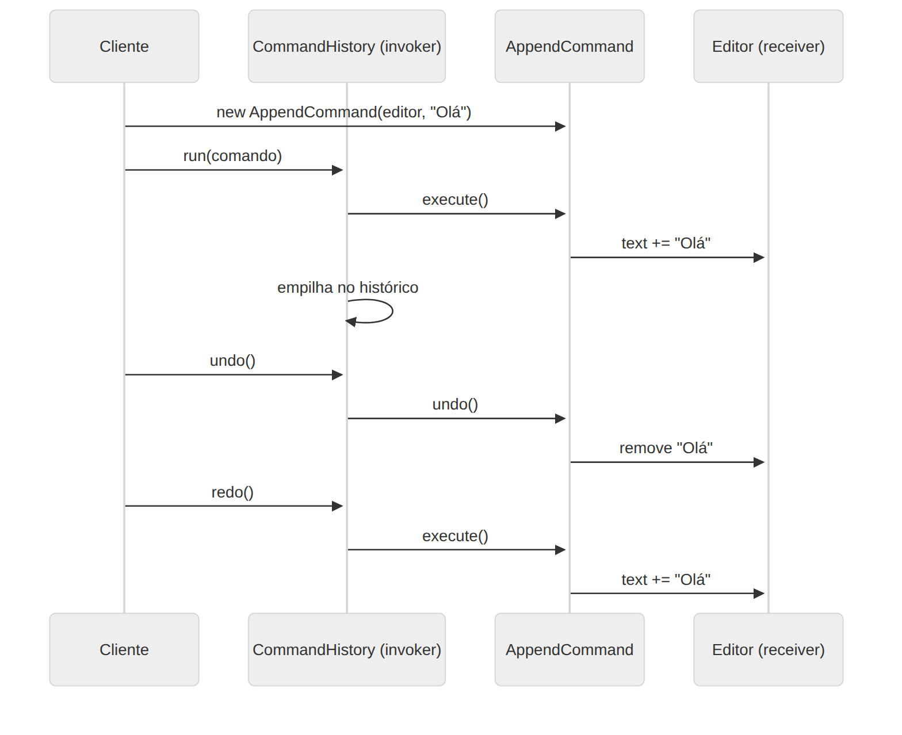

# Command

> **Categoria:** Comportamental · **Também conhecido como:** Ação (*Action*), Transação (*Transaction*)

## Intenção

**Encapsular uma requisição como um objeto**, permitindo parametrizar clientes com diferentes requisições, enfileirar ou registrar requisições e suportar operações que podem ser **desfeitas**.

## O problema

Num editor de texto, o botão "Negrito", o atalho `Ctrl+B` e o item de menu fazem a mesma coisa. Se cada elemento de UI contiver a lógica, ela será duplicada. Pior: como implementar **desfazer**? Cada ação precisa lembrar o estado anterior, e algo precisa guardar o histórico.

## A solução

Transforme cada ação em um **objeto comando** com um método `execute()` (e `undo()`, se for reversível). O comando guarda tudo o que precisa: o **receptor** (quem faz o trabalho) e os **parâmetros**.

O **invocador** (botão, atalho, histórico) só conhece a interface `Command` e chama `execute()`. Ele não sabe o que o comando faz, nem em quem. Como comandos são objetos, você pode **armazená-los**: numa pilha (undo/redo), numa fila (execução atrasada), num log (reexecutar após crash).

## Estrutura





| Participante | Papel | No exemplo |
|---|---|---|
| **Command** | Interface com `execute()` (e `undo()`) | `Command` |
| **ConcreteCommand** | Liga um receptor a uma ação; guarda parâmetros e estado para desfazer | `AppendCommand`, `UppercaseCommand`, `DeleteLastCommand` |
| **Receiver** | Sabe realizar o trabalho | `Editor` |
| **Invoker** | Dispara comandos e (opcionalmente) mantém o histórico | `CommandHistory` |
| **Client** | Cria comandos concretos e define o receptor | `main()` |

## Exemplo prático

[`exemplo.ts`](exemplo.ts) — um editor com desfazer/refazer:

```ts
history.run(new AppendCommand(editor, "Olá"));      // "Olá"
history.run(new UppercaseCommand(editor));          // "OLÁ"
history.undo();                                     // "Olá"
history.redo();                                     // "OLÁ"
```

Cada comando guarda **o necessário para se desfazer**: `AppendCommand` sabe o tamanho do que adicionou; `UppercaseCommand` guarda um *backup* do texto anterior; `DeleteLastCommand` guarda o que apagou. O `CommandHistory` usa duas pilhas (`done` e `undone`).

Executar:

```bash
npx tsx 03-comportamentais/command/exemplo.ts
```

## Quando usar

- Para **parametrizar objetos** com operações (botões de UI, itens de menu, atalhos).
- Para **enfileirar, agendar ou executar remotamente** operações (filas de jobs, *task queues*).
- Para implementar **desfazer/refazer**.
- Para **registrar** operações e reexecutá-las (*event sourcing*, logs de transação, macros).

## Prós e contras

| ✅ Prós | ❌ Contras |
|---|---|
| Desacopla quem **invoca** de quem **executa** | O código fica mais complexo: uma classe por operação |
| Responsabilidade Única | Para operações triviais, uma função/callback resolve |
| Aberto/Fechado: novos comandos sem alterar invocadores | |
| Permite undo/redo, filas, agendamento e macros (comandos compostos) | |

## Dica para TypeScript

Se o comando não precisa desfazer nem ser serializado, uma **função** (`() => void`) já é um comando (*closure*). O padrão completo vale a pena quando você precisa de `undo`, histórico, metadados ou persistência.

## Relação com outros padrões

- **Chain of Responsibility**, **Command**, **Mediator** e **Observer** são formas de ligar remetentes e receptores (veja o [README da categoria](../README.md)).
- Handlers da CoR podem ser implementados como Commands.
- Você pode usar **Command** e **Memento** juntos para implementar *undo*: Commands executam; Mementos guardam o estado. (No exemplo, cada comando guarda seu próprio *backup*, que é uma forma simples de memento.)
- **Prototype** ajuda a salvar cópias de comandos no histórico.
- **Strategy** e Command parecem similares (ambos parametrizam um objeto com uma ação), mas têm intenções distintas: Command **converte uma operação em objeto** (podendo adiar, enfileirar, desfazer); Strategy descreve **diferentes formas de fazer a mesma coisa**.
