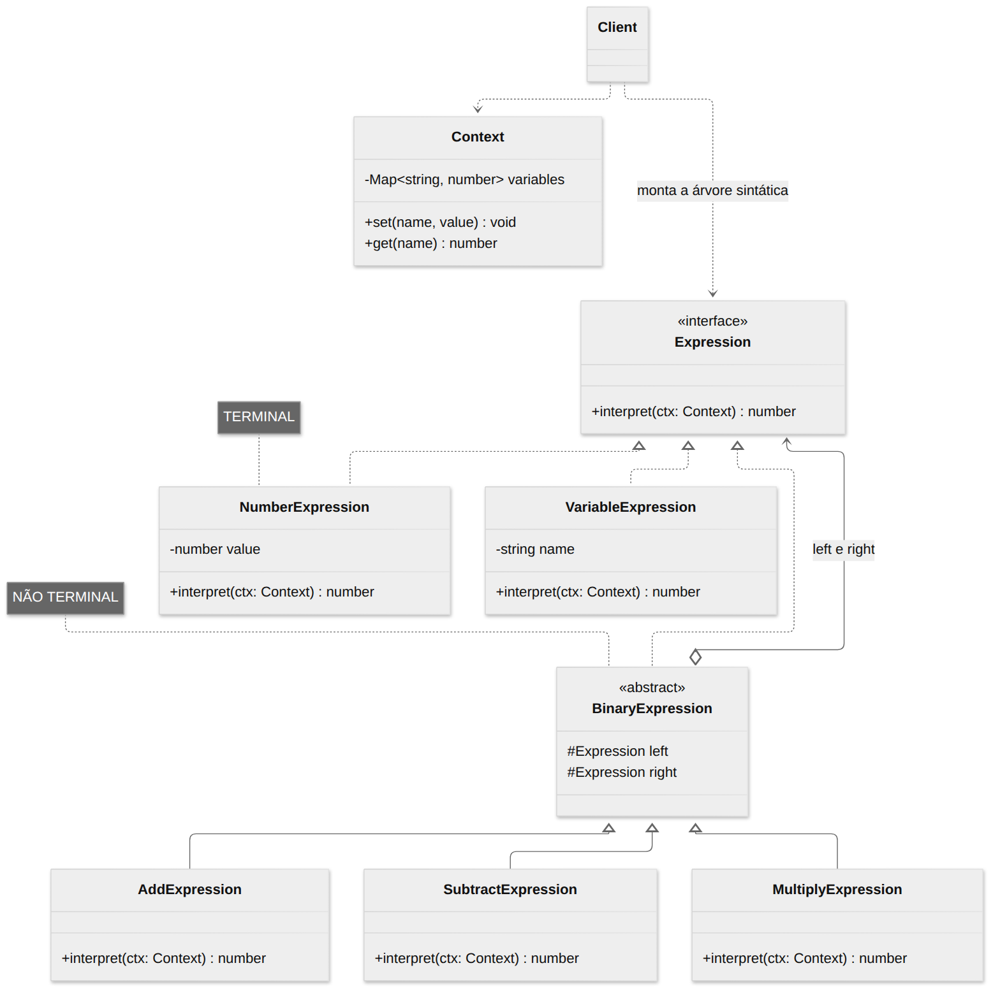
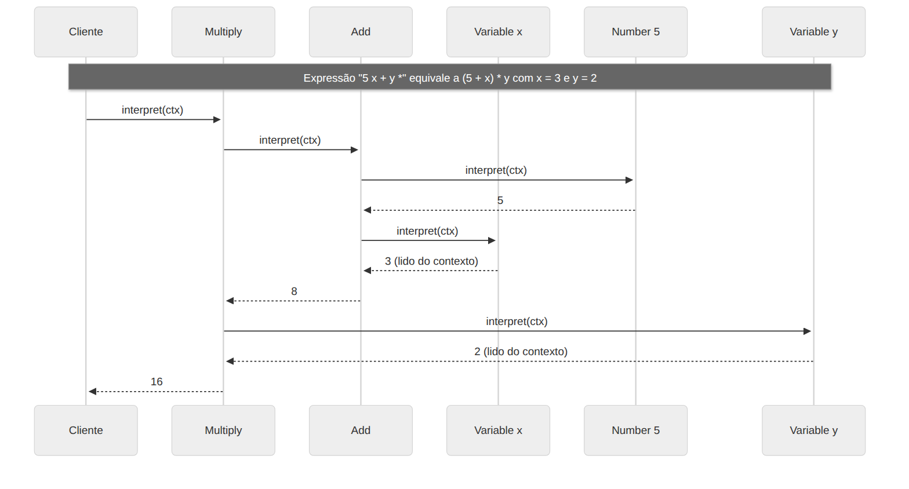

# Interpreter

> **Categoria:** Comportamental

## Intenção

Dada uma linguagem, **definir uma representação para a sua gramática** juntamente com um **interpretador** que usa essa representação para interpretar sentenças da linguagem.

## O problema

Seu sistema precisa avaliar expressões fornecidas pelo usuário em tempo de execução: fórmulas de planilha, regras de negócio (`idade > 18 E pais = "BR"`), filtros de busca, expressões regulares, consultas simples. Escrever `if/switch` para cada combinação não escala, e cada nova regra exige mudar o código.

Se o problema aparece com **frequência** e pode ser descrito como sentenças de uma **linguagem simples**, vale a pena representá-lo assim.

## A solução

1. Escreva a **gramática** da linguagem (veja o comentário no topo do `exemplo.ts`).
2. Crie **uma classe para cada regra** da gramática, todas com um método `interpret(context)`.
3. Uma sentença vira uma **árvore sintática abstrata** (AST) de objetos:
   - **Expressões terminais** (folhas): números, variáveis — interpretadas diretamente.
   - **Expressões não terminais** (nós): operadores — combinam o resultado de suas subexpressões.
4. O **contexto** carrega informações globais (valores de variáveis).

Interpretar a sentença é chamar `interpret()` na raiz; a recursão faz o resto — é o padrão **Composite** aplicado a uma linguagem.

## Estrutura





| Participante | Papel | No exemplo |
|---|---|---|
| **AbstractExpression** | Interface com `interpret(context)` | `Expression` |
| **TerminalExpression** | Regra sem subexpressões | `NumberExpression`, `VariableExpression` |
| **NonterminalExpression** | Regra composta por outras expressões | `AddExpression`, `MultiplyExpression`… |
| **Context** | Informação global para a interpretação | `Context` |
| **Client** | Monta (ou recebe de um parser) a AST e chama `interpret` | `parse()` + `main()` |

## Exemplo prático

[`exemplo.ts`](exemplo.ts) — uma calculadora em notação pós-fixa (RPN) com variáveis:

```
"5 x + y *"   =>   ((5 + x) * y)   =   16      (com x = 3 e y = 2)
```

A mesma árvore pode ser reinterpretada com **outro contexto** (`x = 10, y = 5` → `75`) sem ser reconstruída. Adicionar o operador `^` é criar **uma classe** e registrar em `OPERATORS`.

> O padrão **não** diz como transformar texto em árvore. O `parse()` do exemplo é um detalhe à parte (um *parser* simples com pilha).

Executar:

```bash
npx tsx 03-comportamentais/interpreter/exemplo.ts
```

## Quando usar

- Quando precisa interpretar uma **linguagem simples** e a gramática é **pequena e estável**.
- Quando a **eficiência não é crítica** (para linguagens grandes e rápidas, use geradores de parser).
- Exemplos: regras de validação configuráveis, motores de busca com sintaxe própria, DSLs internas, calculadoras, filtros (`status:aberto AND dono:ana`).

## Prós e contras

| ✅ Prós | ❌ Contras |
|---|---|
| Fácil **mudar e estender** a gramática (nova regra = nova classe) | Gramáticas **complexas** geram muitas classes e ficam difíceis de manter |
| Implementar a gramática é simples (classes parecidas) | Pode ser **lento** comparado a parsers otimizados |
| Aberto/Fechado: novas expressões sem alterar as existentes | Em TypeScript, muitas vezes `eval`-like seguro, JSON ou uma biblioteca de parsing é mais prático |

> ⚠️ Nunca use `eval()`/`new Function()` para interpretar entrada do usuário — é uma falha de segurança. Um Interpreter próprio restringe a linguagem ao que você implementou.

## Relação com outros padrões

- A AST é um exemplo de **Composite**.
- **Iterator** pode percorrer a estrutura; **Visitor** pode manter o comportamento de cada nó fora das classes (útil quando há várias operações sobre a mesma AST — imprimir, avaliar, otimizar).
- Os símbolos terminais podem ser compartilhados com **Flyweight**.
- **Interpreter** ≠ **Command**: Command encapsula uma ação; Interpreter avalia sentenças de uma linguagem.
