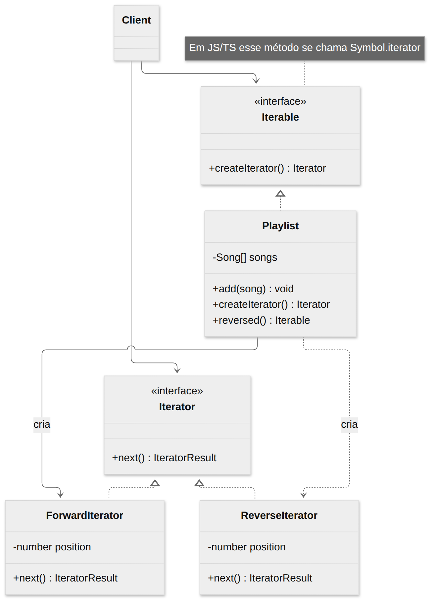
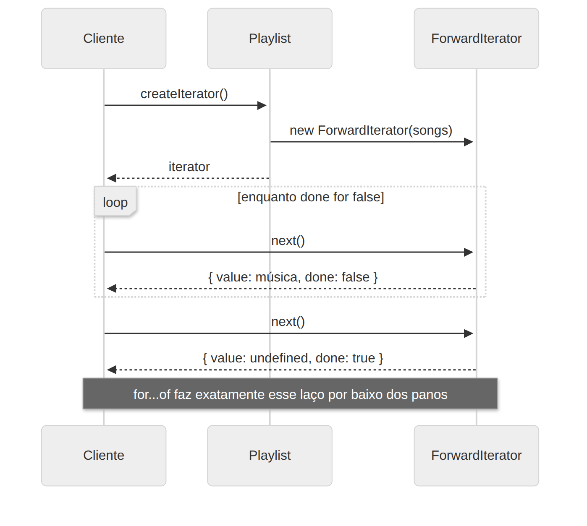

# Iterator

> **Categoria:** Comportamental · **Também conhecido como:** Cursor

## Intenção

Fornecer uma forma de **acessar sequencialmente os elementos** de uma coleção **sem expor sua representação interna** (lista, pilha, árvore…).

## O problema

Coleções guardam dados de formas diferentes: array, lista encadeada, árvore, grafo. Todas precisam de um jeito de serem percorridas. Se o cliente escrever o código de percurso:

- ele fica **acoplado** à estrutura (um laço `for (i...)` não funciona numa árvore);
- a lógica de percurso se **espalha** e se repete pelo programa;
- trocar a estrutura interna (array → árvore) quebra todos os clientes.

E há diferentes **formas** de percorrer: em ordem, reversa, embaralhada, filtrada, em profundidade ou em largura.

## A solução

Extraia o comportamento de percurso para um objeto separado: o **iterador**. Ele encapsula os detalhes (posição atual, quantos elementos faltam) e expõe uma operação simples, `next()`. A coleção fornece um método que **cria** iteradores. Vários iteradores podem percorrer a mesma coleção **ao mesmo tempo**, cada um com seu próprio estado.

## Estrutura





| Participante | Papel | No exemplo |
|---|---|---|
| **Iterator** | Interface de percurso (`next()`) | `Iterator<T>` (nativa) |
| **ConcreteIterator** | Implementa um algoritmo de percurso e guarda a posição | `ForwardIterator`, `ReverseIterator` |
| **Iterable / Collection** | Declara o método que cria iteradores | `Iterable<T>` (nativa) |
| **ConcreteCollection** | Devolve o iterador adequado | `Playlist`, `TreeNode` |
| **Client** | Usa a coleção e o iterador só pelas interfaces | `main()` |

## Exemplo prático

[`exemplo.ts`](exemplo.ts) — três percursos sobre uma `Playlist` e uma árvore binária:

```ts
for (const song of playlist) { ... }              // iterador padrão
for (const song of playlist.reversed()) { ... }   // percurso reverso
[...playlist.byArtist("Queen")];                  // generator filtrando
[...tree];                                        // in-order numa árvore
```

### O padrão já vem na linguagem

| Conceito GoF | JavaScript / TypeScript |
|---|---|
| `createIterator()` | `[Symbol.iterator]()` |
| `next()` / `hasNext()` | `next()` → `{ value, done }` |
| Coleção | Qualquer `Iterable<T>` |
| Cliente percorrendo | `for...of`, `...spread`, `Array.from`, desestruturação |
| Iterador escrito à mão | **Generators** (`function*` e `yield`) — a forma mais curta |

Por isso, em TS você raramente escreve a infraestrutura do zero: implemente `[Symbol.iterator]` (com classe ou *generator*) e toda a linguagem passa a entender sua coleção. O exemplo mostra as duas formas: classes explícitas (para ver as peças) e *generators*.

Executar:

```bash
npx tsx 03-comportamentais/iterator/exemplo.ts
```

## Quando usar

- Quando a coleção tem uma **estrutura complexa** e você quer esconder essa complexidade do cliente.
- Para **reduzir código de percurso duplicado** pela aplicação.
- Quando quer que seu código percorra **estruturas diferentes** (ou desconhecidas de antemão) da mesma forma.
- Para oferecer **vários percursos** da mesma estrutura (em profundidade, em largura, reverso, paginado).

## Prós e contras

| ✅ Prós | ❌ Contras |
|---|---|
| Responsabilidade Única: percurso separado da coleção | Exagero se a aplicação só usa coleções simples |
| Aberto/Fechado: novos percursos sem mexer nas coleções | Pode ser **menos eficiente** que acesso direto em coleções especializadas |
| Pode percorrer a mesma coleção em paralelo (cada iterador com seu estado) | |
| Permite **adiar** o percurso (*lazy*) e pausá-lo | |

## Relação com outros padrões

- Você pode percorrer árvores **Composite** com Iterators.
- **Factory Method** permite que subclasses de coleções devolvam diferentes tipos de iteradores.
- **Memento** + Iterator: guardar o estado de uma iteração para retomá-la depois.
- **Visitor** + Iterator: o iterador percorre a estrutura enquanto o visitor executa operações sobre cada elemento.
