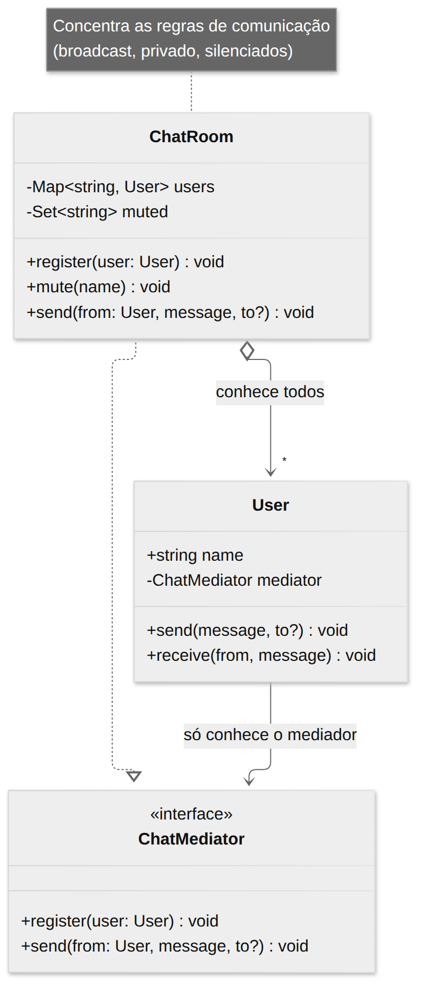
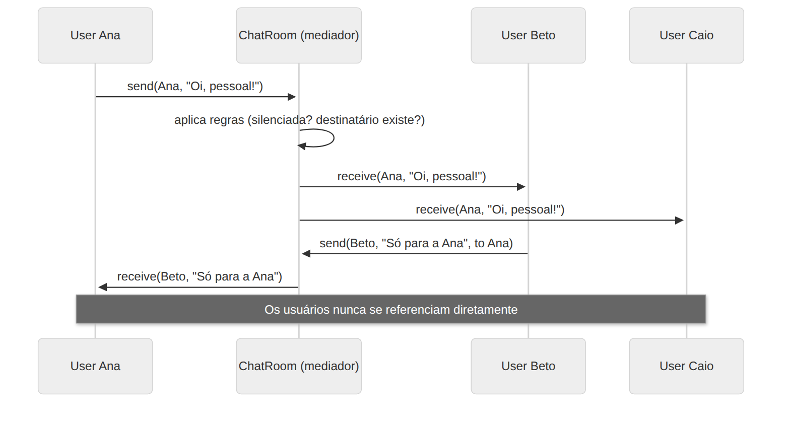

# Mediator

> **Categoria:** Comportamental · **Também conhecido como:** Intermediário, Controlador, *Intermediary*

## Intenção

Definir um objeto que **encapsula como um conjunto de objetos interage**. O Mediator promove **acoplamento fraco** ao evitar que os objetos se refiram uns aos outros explicitamente, e permite variar a interação de forma independente.

## O problema

Numa tela de formulário: ao marcar a *checkbox* "Tenho empresa", aparece o campo CNPJ; o botão "Salvar" só habilita se tudo estiver válido; trocar o país muda a lista de estados. Se cada componente referenciar diretamente os outros, surge uma **teia de dependências**: não dá para reutilizar um componente sem arrastar vários outros junto.

Com **N** objetos conversando entre si, o número de conexões cresce quase com N².

## A solução

Pare toda comunicação direta entre os componentes e faça-os **se comunicar indiretamente**, por meio de um **mediador**. Os componentes conhecem apenas o mediador (um só objeto) e notificam-no sobre eventos; o mediador decide a quem repassar e que reações disparar.

Conexões: de N² para **N**. As regras de interação ficam num **único lugar**, em vez de espalhadas.

Analogia: uma **torre de controle** num aeroporto. Os pilotos não conversam entre si para decidir quem pousa; a torre coordena todos.

## Estrutura





| Participante | Papel | No exemplo |
|---|---|---|
| **Mediator** | Interface de comunicação com os colegas | `ChatMediator` |
| **ConcreteMediator** | Coordena os colegas e implementa as regras de colaboração | `ChatRoom` |
| **Colleague** | Componente com lógica própria; conhece só o mediador | `User` |

## Exemplo prático

[`exemplo.ts`](exemplo.ts) — uma sala de chat. `User.send()` apenas entrega a mensagem ao mediador; é a `ChatRoom` que decide o destino:

```ts
ana.send("Oi, pessoal!");              // broadcast: Beto e Caio recebem
beto.send("Só para a Ana", "Ana");     // privado
room.mute("Beto");                      // regra do mediador: Beto não envia mais
```

Nenhum `User` guarda referência a outro `User`. Novas regras (moderação, histórico, limite de mensagens) entram **só** na `ChatRoom`.

Executar:

```bash
npx tsx 03-comportamentais/mediator/exemplo.ts
```

## Quando usar

- Quando é difícil alterar uma classe porque ela está **fortemente acoplada** a várias outras.
- Quando não consegue **reutilizar** um componente por depender de muitos outros.
- Quando você cria muitas **subclasses só para variar a comunicação** entre objetos.
- Exemplos: diálogos/formulários de UI, controle de tráfego aéreo, salas de chat, *event bus*, controladores em MVC.

## Prós e contras

| ✅ Prós | ❌ Contras |
|---|---|
| Responsabilidade Única: a comunicação fica num só lugar | O mediador pode virar um **objeto deus** (*god object*) |
| Aberto/Fechado: novos mediadores sem mudar os componentes | Concentra complexidade: pode ficar enorme e difícil de manter |
| Reduz o acoplamento entre componentes | |
| Facilita o reúso dos componentes | |

## Relação com outros padrões

| Padrão | Diferença |
|---|---|
| **Observer** | A diferença é sutil. O Mediator **elimina** conexões mútuas: os componentes dependem de um único mediador. O Observer cria conexões **unidirecionais** dinâmicas (assinantes de publicadores). Dá para implementar o Mediator *usando* Observer: o mediador é o assinante dos eventos dos componentes. |
| **Facade** | A fachada oferece interface simplificada a um subsistema, sem que o subsistema saiba dela, e a comunicação é **unidirecional**. No Mediator, os colegas conhecem o mediador e a comunicação é **bidirecional**. |
| **Chain of Responsibility**, **Command** | Outras formas de ligar remetentes e receptores (veja o [README da categoria](../README.md)). |
