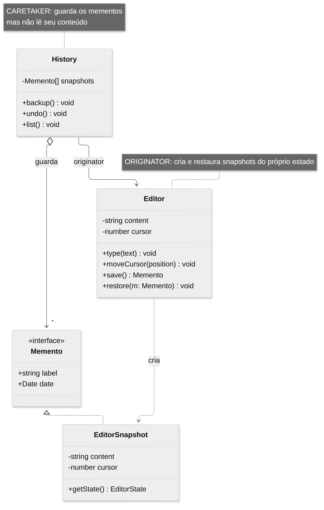
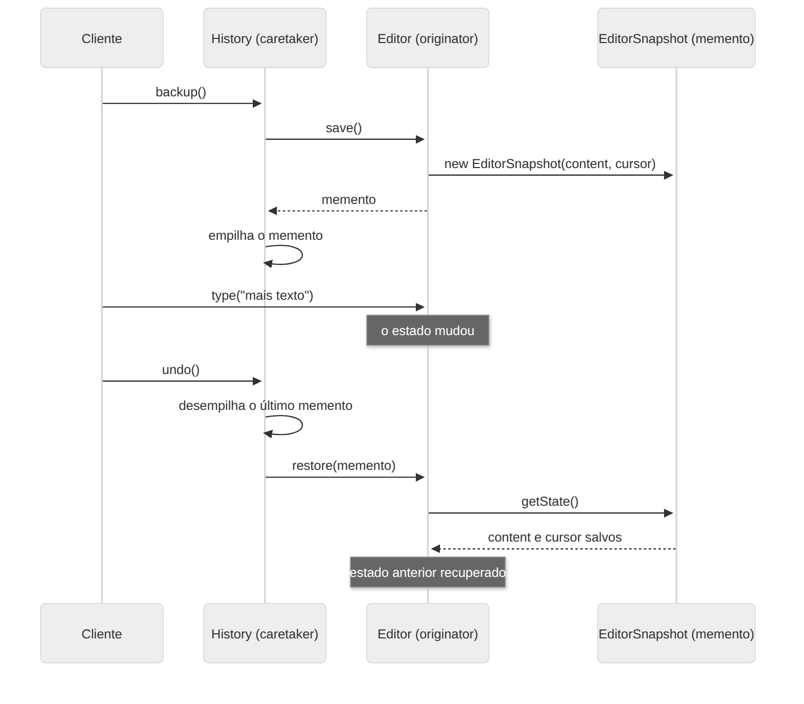

# Memento

> **Categoria:** Comportamental · **Também conhecido como:** Snapshot, Token

## Intenção

Sem violar o encapsulamento, **capturar e externalizar o estado interno de um objeto** para que ele possa ser **restaurado** mais tarde.

## O problema

Você quer implementar "desfazer" num editor: precisa salvar o estado do editor antes de cada operação. Como copiar esse estado?

- Se o editor tem campos **privados**, quem está de fora **não consegue** copiá-los.
- Se você os torna **públicos** para facilitar, quebra o encapsulamento: qualquer classe passa a depender dos detalhes internos e qualquer mudança neles quebra o código externo.

## A solução

Delegue a criação do snapshot ao **próprio dono do estado** (*originador*). Ele cria um objeto especial, o **memento**, contendo uma cópia do seu estado. O memento é guardado por um terceiro, o **zelador** (*caretaker*), que o trata como uma "caixa preta": só vê metadados (rótulo, data) e **não lê nem altera** o conteúdo. Para restaurar, o zelador devolve o memento ao originador, que lê o estado nele guardado.

## Estrutura





| Participante | Papel | No exemplo |
|---|---|---|
| **Originator** | Produz e restaura snapshots do próprio estado | `Editor` |
| **Memento** | Guarda o estado; deve ser **imutável**; expõe só metadados ao zelador | `Memento` (interface) / `EditorSnapshot` |
| **Caretaker** | Decide *quando* salvar/restaurar e guarda os mementos | `History` |

## Exemplo prático

[`exemplo.ts`](exemplo.ts) — editor com histórico de snapshots:

```ts
history.backup("depois de 'Olá'");   // editor.save() → memento, guardado
editor.type(", mundo");              // estado muda
history.undo();                      // editor.restore(memento) → volta ao estado salvo
```

O `History` só enxerga a interface estreita `Memento { label, date }`. Quem lê o estado é apenas o `Editor` (via `getState()` do `EditorSnapshot`).

> Em linguagens como C++ ou Java o memento pode ser uma *classe aninhada* privada. TypeScript não tem esse recurso (nem `friend`); aqui a proteção vem de usar **uma interface estreita** para o zelador e uma classe concreta usada só pelo originador.

Executar:

```bash
npx tsx 03-comportamentais/memento/exemplo.ts
```

## Quando usar

- Quando precisa produzir **snapshots do estado** de um objeto para restaurá-lo depois (undo, checkpoints, *rollback* de transações, *save game*).
- Quando acessar o estado diretamente **violaria o encapsulamento** do objeto.

## Prós e contras

| ✅ Prós | ❌ Contras |
|---|---|
| Snapshots **sem violar** o encapsulamento | Pode consumir **muita memória** se snapshots grandes forem criados com frequência |
| Simplifica o originador: o histórico fica no zelador | Zeladores devem rastrear o ciclo de vida do originador para descartar mementos obsoletos |
| | Em linguagens dinâmicas, não há garantia de que o estado do memento permaneça intacto |

**Otimização:** em vez de guardar o estado completo, guarde apenas as **diferenças** (*deltas*) entre versões.

## Relação com outros padrões

- **Command** + Memento = *undo*: comandos executam; mementos guardam o estado anterior à execução.
- **Iterator** + Memento: capturar o estado de uma iteração e retomá-la depois.
- **Prototype** pode ser uma alternativa mais simples ao Memento quando o estado a guardar é um objeto fácil de clonar e sem vínculos externos.
