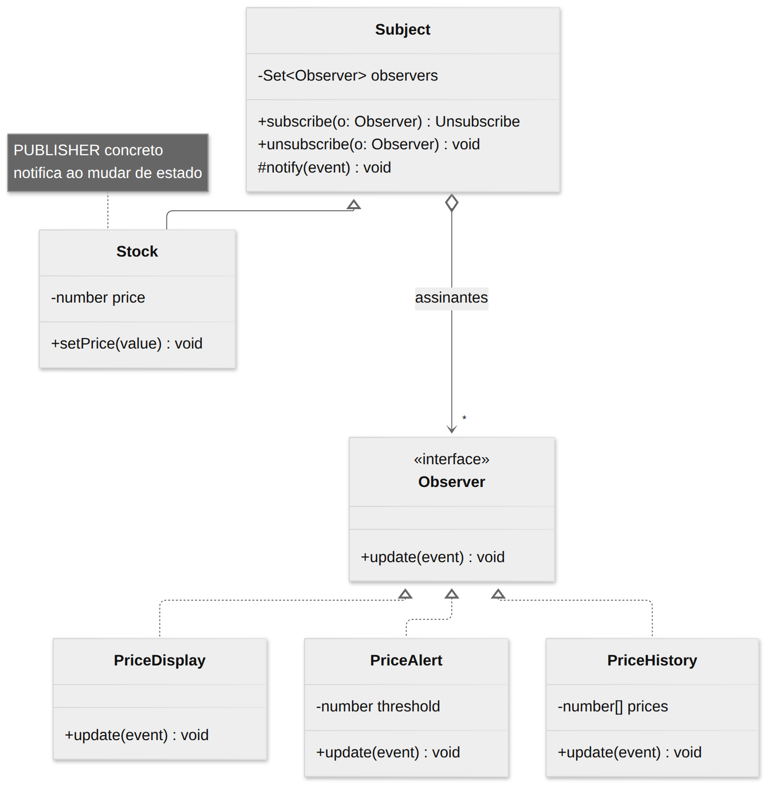
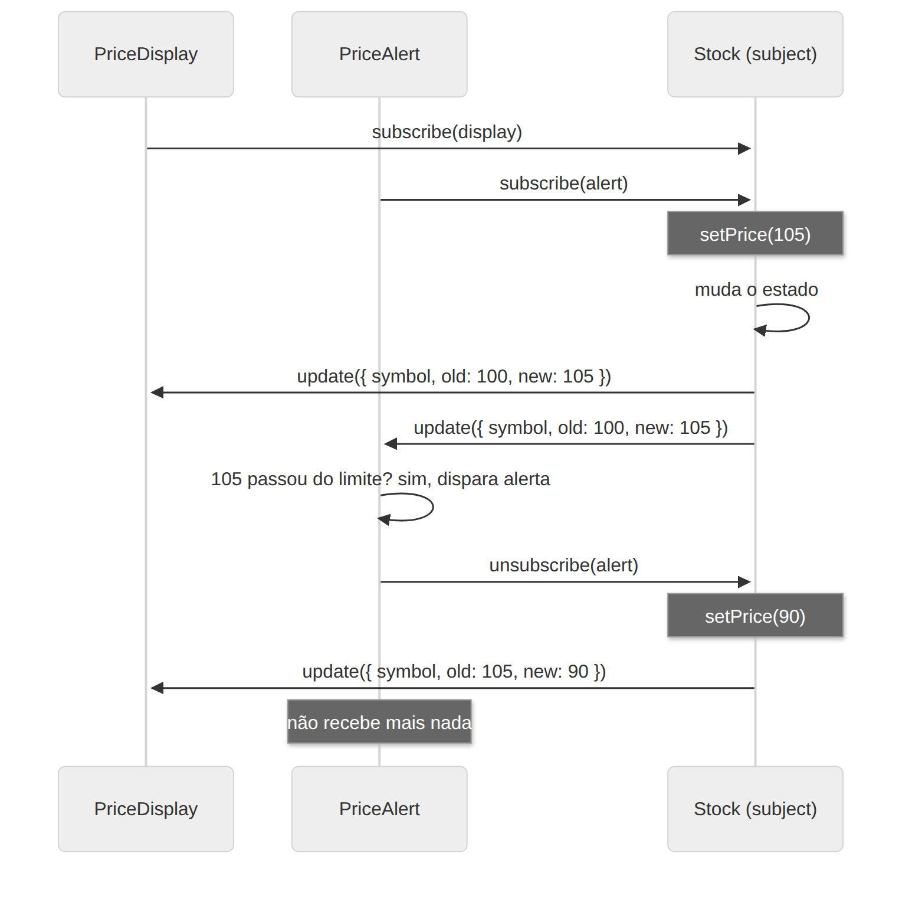

# Observer

> **Categoria:** Comportamental · **Também conhecido como:** Publish-Subscribe (Pub/Sub), Listener, Event Subscriber

## Intenção

Definir uma dependência **um-para-muitos** entre objetos, de modo que, quando um objeto muda de estado, **todos os seus dependentes sejam notificados e atualizados automaticamente**.

## O problema

Uma ação na bolsa tem seu preço atualizado. Há um painel que mostra o preço, um sistema de alertas e um histórico. Como cada um fica sabendo da mudança?

- **Polling:** cada interessado pergunta de tempos em tempos "mudou?". Desperdício de recursos.
- **O publicador chama todos diretamente:** acopla o publicador a todas as classes concretas; toda nova funcionalidade interessada exige mexer nele.

## A solução

O objeto observado (*subject*, ou *publisher*) mantém uma **lista de assinantes** e oferece métodos `subscribe` / `unsubscribe`. Quando algo importante acontece, ele percorre a lista e chama um método de notificação (`update`) de cada assinante. Todos os observers implementam **a mesma interface**, então o publicador não precisa conhecer suas classes concretas. Assinantes podem entrar e sair **em tempo de execução**.

## Estrutura





| Participante | Papel | No exemplo |
|---|---|---|
| **Subject / Publisher** | Mantém assinantes e os notifica | `Subject<T>` / `Stock` |
| **Observer / Subscriber** | Interface de notificação (`update`) | `Observer<T>` |
| **ConcreteObserver** | Reage à notificação | `PriceDisplay`, `PriceAlert`, `PriceHistory` |
| **Client** | Cria publicador e observers e os conecta | `main()` |

## Exemplo prático

[`exemplo.ts`](exemplo.ts) — a `Stock` notifica três observers; um deles cancela a assinatura no meio:

```ts
const stock = new Stock("PETR4", 100);
stock.subscribe(new PriceDisplay());
const cancelAlert = stock.subscribe(new PriceAlert(110));

stock.setPrice(112);   // painel e alerta são avisados
cancelAlert();         // o alerta sai
stock.setPrice(120);   // só o painel continua avisado
```

`subscribe` devolve uma **função de cancelamento** — o jeito idiomático em TypeScript, que evita guardar referências só para `unsubscribe`.

Executar:

```bash
npx tsx 03-comportamentais/observer/exemplo.ts
```

## Onde você já usa Observer

| Tecnologia | Equivalente |
|---|---|
| DOM | `element.addEventListener("click", handler)` |
| Node.js | `EventEmitter` (`on`, `off`, `emit`) |
| RxJS | `Observable.subscribe()` |
| React/Vue/Svelte | Estado reativo, *stores*, `useSyncExternalStore` |
| Mensageria | Tópicos de Kafka/Redis Pub/Sub (variante distribuída) |

## Quando usar

- Quando mudanças no estado de um objeto podem exigir mudanças em **outros objetos**, e o conjunto de dependentes é **desconhecido de antemão** ou **muda dinamicamente**.
- Quando alguns objetos precisam observar outros, mas **apenas por um tempo** ou **em casos específicos**.

## Prós e contras

| ✅ Prós | ❌ Contras |
|---|---|
| Aberto/Fechado: novos assinantes sem alterar o publicador | A **ordem** das notificações não é garantida |
| Estabelece relações entre objetos **em tempo de execução** | **Vazamento de memória** se esquecer de cancelar assinaturas (*lapsed listener*) |
| Baixo acoplamento entre publicador e assinantes | Cascatas de notificações podem ser difíceis de depurar |
| | Um observer que lança exceção pode impedir os seguintes de serem avisados (o exemplo não trata isso) |

## Relação com outros padrões

- **Chain of Responsibility**, **Command**, **Mediator** e **Observer** são formas de ligar remetentes e receptores (veja o [README da categoria](../README.md)).
- A diferença para **Mediator** é sutil: o Mediator elimina dependências mútuas, forçando comunicação por um intermediário; o Observer cria conexões **unidirecionais** dinâmicas. Pode-se implementar um Mediator usando Observer.
