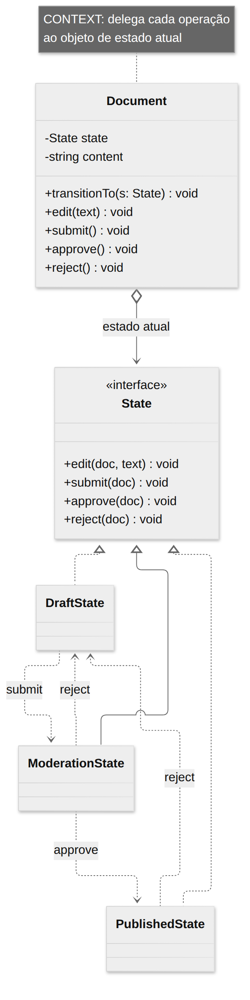
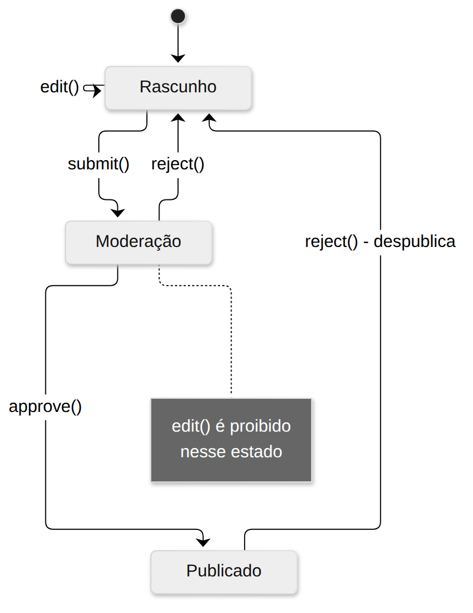
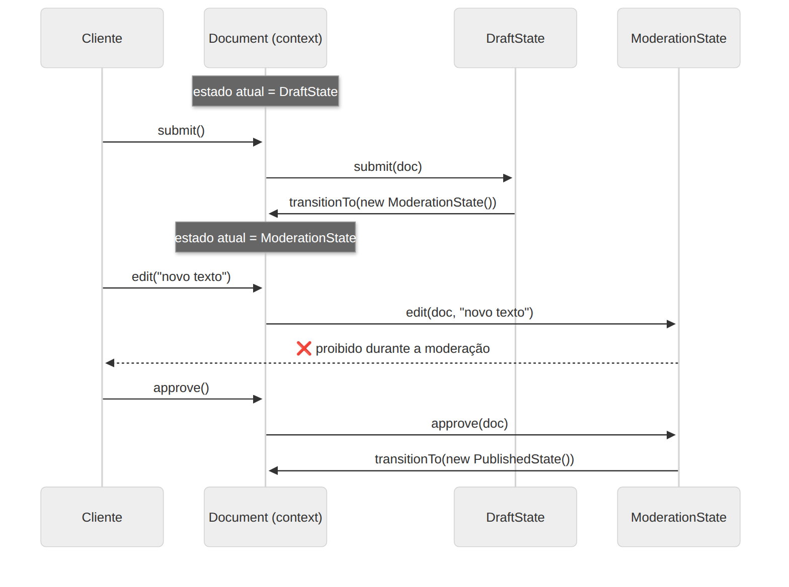

# State

> **Categoria:** Comportamental · **Também conhecido como:** Objetos para Estados

## Intenção

Permitir que um objeto **altere seu comportamento quando seu estado interno muda**. O objeto parecerá ter mudado de classe.

## O problema

Um documento passa por **Rascunho → Moderação → Publicado**. O método `publish()` faz coisas diferentes em cada estado; `edit()` só funciona no rascunho. A abordagem ingênua usa `if/switch` em **cada método**:

```ts
edit(text) {
  if (this.status === "rascunho") { ... }
  else if (this.status === "moderacao") { throw ... }
  else if (this.status === "publicado") { throw ... }
}
```

Com mais estados e operações, a condicional se multiplica por **todos os métodos**, e adicionar um estado novo exige mexer em tudo. É uma **máquina de estados finitos** escrita à mão.

## A solução

Crie **uma classe para cada estado** e mova para ela o comportamento específico daquele estado. O objeto original (**contexto**) guarda uma referência ao estado atual e **delega** o trabalho a ele. Para mudar de estado, troca-se o objeto referenciado. Os próprios estados costumam decidir a **transição** (`doc.transitionTo(...)`).

## Estrutura







| Participante | Papel | No exemplo |
|---|---|---|
| **Context** | Guarda o estado atual e delega a ele | `Document` |
| **State** | Interface comum a todos os estados | `State` |
| **ConcreteState** | Implementa o comportamento de um estado e as transições | `DraftState`, `ModerationState`, `PublishedState` |

## Exemplo prático

[`exemplo.ts`](exemplo.ts) — o fluxo de publicação. Repare que `Document` **não tem nenhum `if` sobre o estado**:

```ts
class Document {
  private state: State = new DraftState();
  edit(text: string)  { this.state.edit(this, text); }   // delega
  submit()            { this.state.submit(this); }
  transitionTo(s: State) { this.state = s; }
}
```

Executar:

```bash
npx tsx 03-comportamentais/state/exemplo.ts
```

Para criar o estado "Arquivado", basta uma nova classe e algumas transições; o `Document` não muda.

## Quando usar

- Quando o comportamento de um objeto **depende do seu estado**, há **muitos estados** e o código específico de cada um **muda com frequência**.
- Quando uma classe está poluída com **condicionais enormes** que alteram o comportamento conforme os valores de seus campos.
- Quando há muito **código duplicado** entre estados e transições de uma máquina de estados baseada em condições.

## Prós e contras

| ✅ Prós | ❌ Contras |
|---|---|
| Responsabilidade Única: código de cada estado em sua classe | Exagero se há **poucos estados** ou eles raramente mudam |
| Aberto/Fechado: novos estados sem mudar contexto e estados existentes | Muitas classes pequenas |
| Elimina condicionais volumosas | As transições ficam distribuídas entre os estados (para visualizá-las, desenhe o diagrama) |

## Dica para TypeScript

Para poucos estados e dados simples, um **tipo união discriminado** com `switch` exaustivo já é seguro e conciso:

```ts
type Status = "rascunho" | "moderacao" | "publicado";
```

O padrão State compensa quando cada estado tem **comportamento e dados próprios** ou há muitas operações.

## Relação com outros padrões

- **State** e **Strategy** têm estrutura quase idêntica (composição + delegação), mas **intenções diferentes**:
  - **Strategy:** o cliente escolhe o algoritmo; as estratégias são **independentes** e **não se conhecem**.
  - **State:** os estados **se conhecem** e disparam transições entre si; o objeto muda de estado sozinho.
- **State** pode ser visto como uma extensão de **Strategy**.
- **Bridge** também usa composição e delegação, mas resolve outro problema (separar hierarquias).
