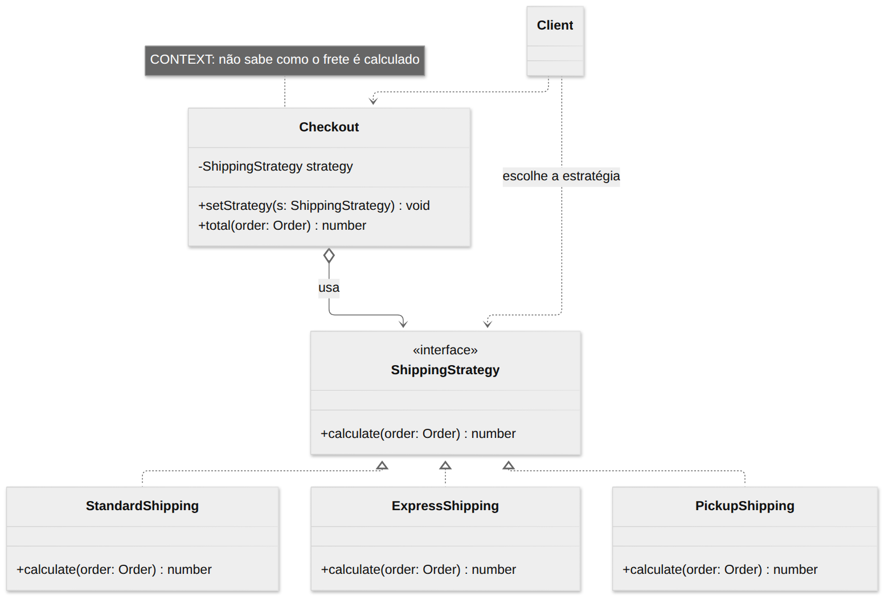
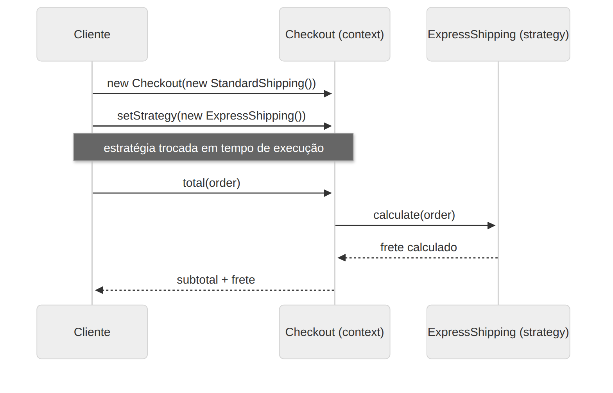

# Strategy

> **Categoria:** Comportamental · **Também conhecido como:** Policy (Política)

## Intenção

Definir uma **família de algoritmos**, encapsular cada um deles e torná-los **intercambiáveis**. O Strategy permite que o algoritmo varie independentemente dos clientes que o utilizam.

## O problema

Sua loja calcula frete: padrão, expresso, retirada na loja, frete grátis acima de certo valor… Se tudo ficar na classe `Checkout`, ela vira uma sequência de `if/else` que cresce a cada nova regra, mistura responsabilidades e é difícil de testar: qualquer ajuste numa regra arrisca quebrar as outras.

```ts
if (tipo === "padrao") { ... }
else if (tipo === "expresso") { ... }
else if (tipo === "retirada") { ... }   // e assim por diante
```

## A solução

Extraia cada algoritmo para uma **classe própria** (a *estratégia*), todas com a mesma interface. A classe original (**contexto**) guarda uma referência a uma estratégia e **delega** o trabalho a ela, em vez de executar a lógica por conta própria. O **cliente** escolhe a estratégia e a injeta no contexto — podendo trocá-la a qualquer momento.

## Estrutura





| Participante | Papel | No exemplo |
|---|---|---|
| **Strategy** | Interface comum dos algoritmos | `ShippingStrategy` |
| **ConcreteStrategy** | Implementa um algoritmo | `StandardShipping`, `ExpressShipping`, `PickupShipping`, `FreeShippingOver` |
| **Context** | Mantém uma estratégia e a executa | `Checkout` |
| **Client** | Escolhe a estratégia e a passa ao contexto | `main()` |

## Exemplo prático

[`exemplo.ts`](exemplo.ts) — o mesmo `Checkout` com cálculos de frete diferentes:

```ts
const checkout = new Checkout(new StandardShipping());
checkout.total(order);                       // frete padrão
checkout.setStrategy(new ExpressShipping()); // troca em runtime
checkout.total(order);                       // frete expresso
```

O exemplo mostra também que uma estratégia pode **envolver outra** (`FreeShippingOver` delega ao frete padrão abaixo do valor mínimo) e a **versão funcional**: em TypeScript, uma estratégia simples pode ser só uma função (`type ShippingFn = (o: Order) => number`).

Executar:

```bash
npx tsx 03-comportamentais/strategy/exemplo.ts
```

## Quando usar

- Quando quer usar **diferentes variantes de um algoritmo** dentro de um objeto e trocá-las em tempo de execução.
- Quando tem muitas classes parecidas que só diferem na **forma de executar** algum comportamento.
- Para **isolar a lógica de negócio** dos detalhes de implementação de algoritmos.
- Quando a classe tem um **grande `switch`** que escolhe entre variantes do mesmo algoritmo.
- Exemplos reais: ordenação (`Array.sort(comparador)`), compressão, validação, cálculo de preços/impostos, estratégias de autenticação (Passport.js), roteamento.

## Prós e contras

| ✅ Prós | ❌ Contras |
|---|---|
| Troca algoritmos **em tempo de execução** | Exagero se há só alguns algoritmos que raramente mudam |
| Isola implementação do algoritmo do código que o usa | O cliente precisa **conhecer as diferenças** entre as estratégias para escolher a certa |
| **Composição** no lugar de herança | Em linguagens com funções de primeira classe, muitas vezes uma função/lambda resolve |
| Aberto/Fechado: novas estratégias sem mudar o contexto | |

## Relação com outros padrões

| Padrão | Diferença |
|---|---|
| **State** | Estrutura quase igual. No Strategy as estratégias **não se conhecem** e o cliente as escolhe. No State os estados **se conhecem** e disparam transições. |
| **Template Method** | Usa **herança** (altera partes do algoritmo via subclasses, estático, em nível de classe). Strategy usa **composição** (troca o algoritmo inteiro, dinâmico, em nível de objeto). |
| **Command** | Ambos parametrizam um objeto com uma ação, mas Command **converte uma operação em objeto** (para enfileirar, desfazer, registrar); Strategy descreve **formas alternativas** de fazer a mesma coisa. |
| **Decorator** | Muda a "pele" do objeto; Strategy muda suas "entranhas". |
| **Bridge** | Estrutura parecida, mas resolve outro problema: separar hierarquias de abstração e implementação. |
