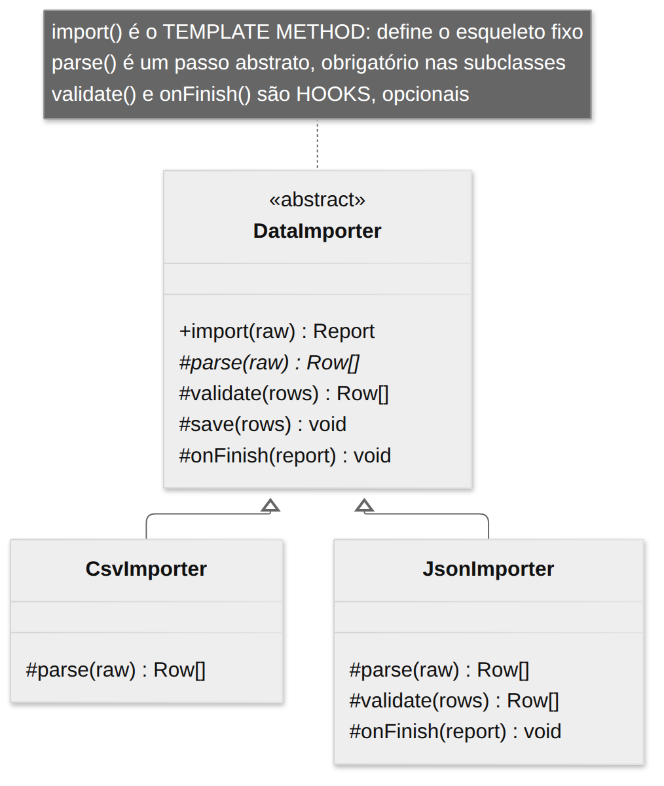
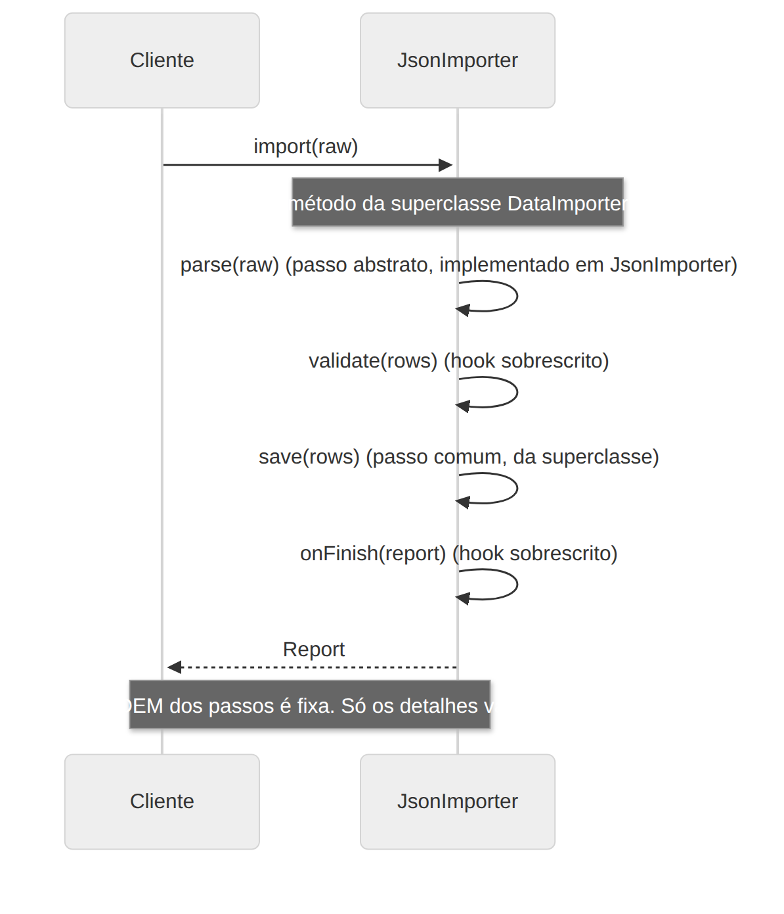

# Template Method

> **Categoria:** Comportamental · **Também conhecido como:** Método Padrão, Método Gabarito

## Intenção

Definir o **esqueleto de um algoritmo** numa operação, **adiando alguns passos para as subclasses**. O Template Method permite que subclasses redefinam certos passos de um algoritmo **sem mudar sua estrutura**.

## O problema

Você escreve importadores de dados. O de CSV e o de JSON fazem quase tudo igual: ler, converter, validar, salvar, gerar relatório. Só a etapa de *converter* difere. Copiar e colar o algoritmo em cada classe gera **duplicação**: uma correção na etapa "salvar" precisa ser repetida em todos os importadores.

## A solução

Divida o algoritmo em **passos** e transforme cada um em um método. Chame esses métodos, na ordem certa, dentro de um único **método-modelo** (*template method*) na superclasse. Os passos podem ser:

| Tipo de passo | Descrição | No exemplo |
|---|---|---|
| **Abstrato** | Todas as subclasses **devem** implementar | `parse()` |
| **Opcional com padrão** (*hook*) | Tem implementação padrão que pode ser sobrescrita | `validate()` |
| **Hook vazio** | Ponto de extensão, não faz nada por padrão | `onFinish()` |
| **Concreto** | Igual para todos; já implementado | `save()` |

As subclasses preenchem as lacunas, mas **não alteram a ordem** do algoritmo.

> Princípio de Hollywood: *"Não nos chame, nós chamamos você."* A superclasse chama as subclasses, e não o contrário.

## Estrutura





| Participante | Papel | No exemplo |
|---|---|---|
| **AbstractClass** | Define o template method e os passos | `DataImporter` |
| **ConcreteClass** | Implementa os passos abstratos e, opcionalmente, os hooks | `CsvImporter`, `JsonImporter` |

## Exemplo prático

[`exemplo.ts`](exemplo.ts) — `CsvImporter` só implementa `parse()`; `JsonImporter` implementa `parse()` e sobrescreve os hooks `validate()` e `onFinish()`:

```ts
abstract class DataImporter {
  import(raw: string): Report {         // ← template method
    const rows  = this.parse(raw);      // abstrato
    const valid = this.validate(rows);  // hook
    this.save(valid);                   // concreto
    ...
    this.onFinish(report);              // hook vazio
  }
}
```

Executar:

```bash
npx tsx 03-comportamentais/template-method/exemplo.ts
```

## Quando usar

- Quando quer que clientes estendam **apenas passos específicos** de um algoritmo, não o algoritmo inteiro nem sua estrutura.
- Quando várias classes têm algoritmos **quase idênticos**, com pequenas diferenças: evita duplicação.
- Em **frameworks**: o framework define o fluxo e você preenche os pontos de extensão (ciclo de vida de componentes, testes com `setUp`/`tearDown`).

## Prós e contras

| ✅ Prós | ❌ Contras |
|---|---|
| Subclasses sobrescrevem só partes do algoritmo, o que reduz o impacto de mudanças | Você fica limitado pelo esqueleto fornecido |
| Elimina código duplicado, movendo-o para a superclasse | Pode violar o Princípio da Substituição de Liskov se uma subclasse suprimir um passo padrão |
| | Quanto mais passos, **mais difícil** manter o template |
| | Usa **herança**, que é mais rígida que composição |

> Em TypeScript, o `override` (com `noImplicitOverride`) ajuda a ver claramente quais passos cada subclasse sobrescreve.

## Relação com outros padrões

- **Factory Method** é uma especialização do Template Method (e costuma ser um passo dele).
- **Template Method** usa **herança** (estático, em nível de classe); **Strategy** usa **composição** (dinâmico, em nível de objeto): o Strategy permite trocar o algoritmo inteiro em tempo de execução.
