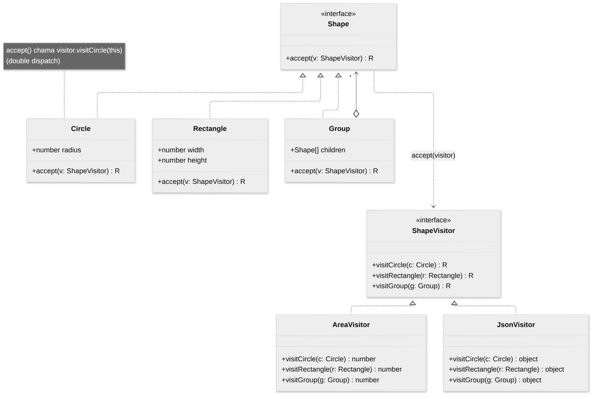
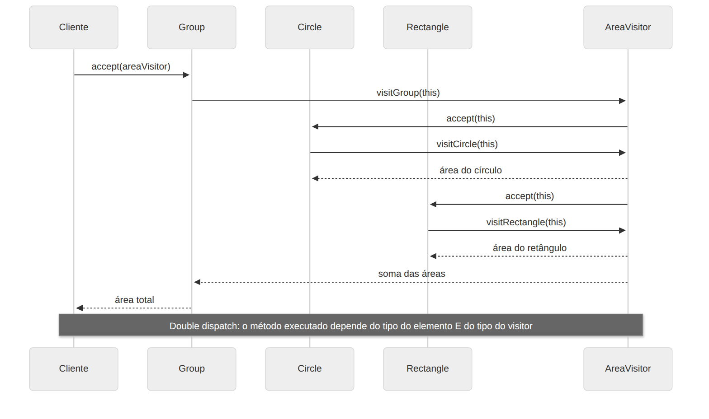

# Visitor

> **Categoria:** Comportamental · **Também conhecido como:** Visitante

## Intenção

Representar uma **operação a ser executada sobre os elementos** de uma estrutura de objetos. O Visitor permite definir uma **nova operação sem alterar as classes** dos elementos sobre os quais opera.

## O problema

Você tem uma estrutura de formas (círculo, retângulo, grupos) e precisa de operações: calcular área, exportar para JSON, desenhar, validar… Colocar cada operação **dentro** das classes das formas:

- infla as classes com responsabilidades que não são delas (Responsabilidade Única);
- exige mexer em **todas** as formas a cada operação nova;
- é perigoso se as classes são estáveis, de terceiros, ou já estão em produção.

## A solução

Mova as operações para classes separadas, os **visitors**. Cada visitor tem **um método para cada tipo de elemento** (`visitCircle`, `visitRectangle`…). Cada elemento ganha apenas **um** método, `accept(visitor)`, que chama o método certo do visitor passando `this`:

```ts
class Circle {
  accept<R>(visitor: ShapeVisitor<R>): R {
    return visitor.visitCircle(this);   // "me visite como círculo"
  }
}
```

Esse truque é o **double dispatch** (despacho duplo): a linguagem só escolhe o método pelo tipo do objeto em que ele é chamado (*single dispatch*). Com duas chamadas em cadeia (`shape.accept(visitor)` → `visitor.visitCircle(shape)`), o código executado passa a depender do tipo do **elemento** *e* do tipo do **visitor**.

## Estrutura





| Participante | Papel | No exemplo |
|---|---|---|
| **Visitor** | Interface com um `visit*` por tipo de elemento | `ShapeVisitor<R>` |
| **ConcreteVisitor** | Implementa uma operação para todos os tipos | `AreaVisitor`, `JsonExportVisitor`, `OutlineVisitor` |
| **Element** | Interface com `accept(visitor)` | `Shape` |
| **ConcreteElement** | Implementa `accept`, chamando o `visit*` correspondente | `Circle`, `Rectangle`, `Group` |
| **Client** | Percorre a estrutura e aplica o visitor | `main()` |

## Exemplo prático

[`exemplo.ts`](exemplo.ts) — três operações sobre a mesma árvore, sem tocar nas formas:

```ts
drawing.accept(new AreaVisitor());        // → 28.71  (number)
drawing.accept(new JsonExportVisitor());  // → '{"type":"group",...}'  (string)
drawing.accept(new OutlineVisitor());     // → lista de linhas de texto
```

O visitor é **genérico no tipo de retorno** (`ShapeVisitor<R>`), então cada operação devolve o tipo que fizer sentido. Para `Group`, o próprio visitor percorre os filhos chamando `child.accept(this)` — a recursão sobre a árvore (como no **Composite**) fica sob controle do visitor.

Executar:

```bash
npx tsx 03-comportamentais/visitor/exemplo.ts
```

## Quando usar

- Quando precisa executar uma operação em **todos os elementos de uma estrutura complexa** (como uma árvore de objetos).
- Para **separar lógica de negócio auxiliar** (exportar, validar, renderizar) das classes de domínio principais.
- Quando um comportamento só faz sentido para **algumas** classes de uma hierarquia, mas não para outras.
- Típico em **compiladores**: percorrer a AST para checar tipos, otimizar, gerar código.

## Prós e contras

| ✅ Prós | ❌ Contras |
|---|---|
| Aberto/Fechado: novas operações sem mudar as classes dos elementos | A cada **novo tipo de elemento**, é preciso atualizar **todos** os visitors |
| Responsabilidade Única: operações relacionadas ficam juntas | Visitors podem precisar de acesso a membros privados dos elementos, quebrando o encapsulamento |
| Pode acumular informação ao percorrer a estrutura | Conceito de double dispatch é pouco intuitivo |

> O Visitor é bom quando a hierarquia de **elementos é estável** e as **operações mudam com frequência**. Se for o contrário (novos tipos o tempo todo), prefira métodos nas próprias classes.

## Alternativa idiomática em TypeScript

Com **uniões discriminadas** e `switch` exaustivo, o compilador garante que você tratou todos os tipos, sem `accept`/`visit`:

```ts
type Shape =
  | { kind: "circle"; radius: number }
  | { kind: "rectangle"; width: number; height: number };

function area(s: Shape): number {
  switch (s.kind) {
    case "circle": return Math.PI * s.radius ** 2;
    case "rectangle": return s.width * s.height;
  }
}
```

Use o Visitor "clássico" quando os elementos são **classes com comportamento** e há **estruturas recursivas** ou bibliotecas que o esperam.

## Relação com outros padrões

- **Visitor** é como um **Command** poderoso: pode executar operações sobre vários objetos de classes diferentes.
- Você pode usar Visitor para executar uma operação sobre uma árvore **Composite** inteira.
- Use **Iterator** para percorrer a estrutura e Visitor para executar a operação em cada elemento.
- Visitor é frequente com **Interpreter** (operações sobre a AST).
